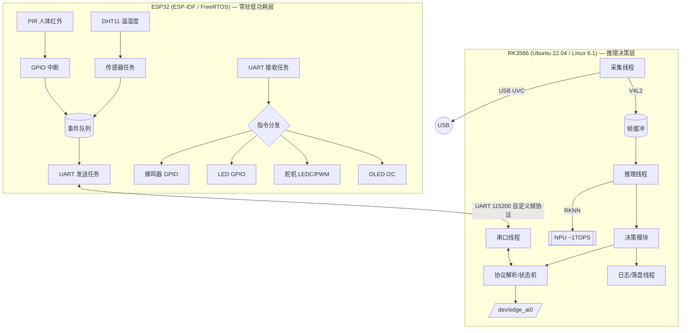
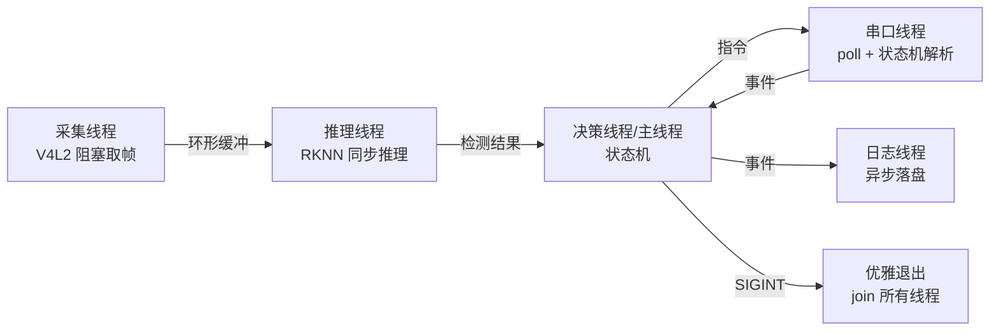

# 项目规格书：边缘 AI 双芯感知节点

> 本文是项目的「实现契约」。PLAN.md 回答**学什么**，本文回答**做成什么、做到什么程度、怎么实现**。
> 版本：v1.0（2026-09-10 定稿）

---

## 1. 产品定义

### 1.1 一句话

> 一台**低功耗 MCU 常驻侦测 + Linux NPU 按需重推理**的区域智能安防节点。

### 1.2 演示剧本（Demo Script）

这是验收当天要完整走通的流程，也是拍演示视频的分镜：

| # | 场景动作 | 系统反应 | 观察者看到什么 |
|---|---------|---------|--------------|
| 1 | 系统上电，无人接近 | ESP32 常驻侦测 PIR，RK3566 摄像头休眠、应用待机 | OLED 显示 `STANDBY`，功耗低 |
| 2 | 人走进监测区域 | PIR 触发 → ESP32 通过 UART 上报事件 → RK3566 唤醒摄像头 + NPU 推理 | 终端打印事件日志，OLED 变 `CHECKING` |
| 3 | NPU 确认画面中有人 | RK3566 下发指令 → ESP32 蜂鸣器报警 + LED 红闪 + 舵机转向目标方向 | 蜂鸣器响、云台转动、屏幕显示 `ALARM` |
| 4 | 人离开画面 3 秒 | RK3566 判定事件结束 → 下发复位 → ESP32 停报警、归位 | OLED 回 `STANDBY`，事件记录落盘 |
| 5 | 查看历史 | 本地事件日志（时间戳 + 快照图 + 温度） | `alerts/` 目录下有条目，可按时间回放 |

### 1.3 为什么选这个场景

| 理由 | 说明 |
|------|------|
| **双芯分工有硬道理** | PIR 常驻侦测只需 μA 级功耗，MCU 胜任；视觉推理需 ~1 TOPS，必须上 NPU。这不是"为了用两个芯片而用"，而是**功耗与算力的分层** |
| **闭环完整** | 感知 → 推理 → 决策 → 执行，四段齐全，恰好覆盖所有学习目标 |
| **可量化** | 延迟、帧率、准确率、功耗都可测，能写进简历 |
| **硬件便宜** | 除已有板卡外，外设总成本 < 150 元 |
| **演示直观** | 蜂鸣器 + 转动的云台 + 屏幕，比纯终端日志有说服力 |

---

## 2. 功能需求（FR）

优先级：**P0 = MVP 必须**，P1 = 应该做，P2 = 加分项。

### 2.1 ESP32 侧（感知端 + 执行端）

| ID | 需求 | 优先级 | 验收方式 |
|----|------|--------|---------|
| FR-01 | PIR 人体红外传感器中断触发，去抖 ≤ 50ms | P0 | 手挥过传感器，串口 100ms 内打印触发 |
| FR-02 | 周期采集环境温湿度（DHT11/BME280），30s 一次 | P1 | 串口日志数值与室温相符 ±2℃ |
| FR-03 | 驱动有源蜂鸣器（报警音） | P0 | 收到指令 200ms 内响 |
| FR-04 | 驱动双色 LED 指示状态（待机/检测中/报警） | P0 | 三种状态肉眼可辨 |
| FR-05 | 驱动 SG90 舵机云台，接收角度指令（0-180°） | P1 | 下发 90° 转到中间，误差 ±5° |
| FR-06 | 驱动 SSD1306 OLED 显示当前状态文本 | P1 | 屏幕内容随状态变化 |
| FR-07 | 上电自检 + 心跳上报（每 5s） | P0 | 串口每 5s 一帧心跳 |
| FR-08 | 断线检测：10s 收不到 RK3566 心跳则进入本地安全模式 | P2 | 拔掉串口线，LED 转为慢闪 |

### 2.2 RK3566 侧（网关 + 推理 + 决策）

| ID | 需求 | 优先级 | 验收方式 |
|----|------|--------|---------|
| FR-20 | V4L2 打开 USB 摄像头，采集 YUYV/MJPEG 帧 | P0 | 能存下 1 张 640×480 JPEG |
| FR-21 | UART 收发，帧协议解析 + CRC 校验 | P0 | 自环测试 1000 帧 0 误码 |
| FR-22 | 事件驱动状态机：STANDBY → CHECKING → ALARM → COOLDOWN | P0 | 状态迁移日志可读 |
| FR-23 | RKNN 加载 `.rknn` 模型，NPU 推理人体检测 | P0 | 输出 bbox 并画框 |
| FR-24 | 决策逻辑：连续 N 帧检出且置信度 > 阈值才判 ALARM | P0 | 误报率可通过参数调优 |
| FR-25 | 多线程应用：采集 / 推理 / 串口 / 日志 线程分离 | P0 | `top` 看到多线程，无死锁 |
| FR-26 | 异常防护：摄像头拔出、串口断开不崩溃 | P0 | 热插拔后应用仍存活 |
| FR-27 | 事件落盘：时间戳 + 快照 + 温度 → `alerts/` | P1 | 目录结构符合约定 |
| FR-28 | 字符设备驱动：向用户态暴露事件队列（ioctl/read） | P1 | 教学性质，见 §7.3 |
| FR-29 | 日志分级（DEBUG/INFO/WARN/ERROR）+ 滚动 | P1 | 可运行时调级别 |
| FR-30 | 性能统计输出（FPS / 推理耗时 / 端到端延迟） | P1 | 退出时打印汇总 |

### 2.3 通信协议

| ID | 需求 | 优先级 | 验收方式 |
|----|------|--------|---------|
| FR-40 | 自定义二进制帧协议，含 SOF/LEN/CMD/SEQ/PAYLOAD/CRC16 | P0 | 见 §5 协议定义 |
| FR-41 | 错误帧被静默丢弃并计数，不中断通信 | P0 | 注入随机字节，通信恢复正常 |
| FR-42 | 关键指令（报警）带 ACK 重传，最多 3 次 | P1 | 丢包场景下仍能送达 |
| FR-43 | 粘包/半包正确处理（环形缓冲 + 状态机解析） | P0 | 一次性发 5 帧，全部正确解析 |

---

## 3. 非功能需求与量化指标

这些数字是**简历上的核心卖点**，必须实测记录。

| 指标 | 目标值 | 测量方法 |
|------|--------|---------|
| **端到端延迟**（PIR 触发 → 蜂鸣器响） | 冷启动 < 2.0s；稳态 < 800ms | 秒表 + 高速摄像对帧，或用 GPIO 打点示波器测 |
| **推理帧率** | ≥ 8 FPS @ 640×640 INT8 | 应用内 `gettimeofday` 统计 |
| **检测召回率** | ≥ 90%（自建 100 张测试集，简单室内场景） | 离线跑测试集统计 |
| **误报率** | ≤ 5%（连续 2h 无人值守测试） | 统计 ALARM 次数 vs 真实事件数 |
| **长稳运行** | 连续 24h 无崩溃、无内存泄漏（RSS 增长 < 10%） | `valgrind`/周期采样 RSS |
| **CPU 占用** | 推理稳态 < 60%（单核折算） | `top -H` |
| **内存占用** | 应用 RSS < 400MB（板子仅 2GB） | `ps aux` |
| **串口误码率** | 115200bps 下 1000 帧 0 错误 | 自环压测脚本 |
| **功耗对比** | STANDBY 模式整机功耗 < 工作模式 60% | USB 电流表测 |

---

## 4. 技术方案

### 4.1 系统架构



### 4.2 关键选型与理由

| 决策点 | 选择 | 理由 | 备选方案 |
|--------|------|------|---------|
| 主控 OS | Ubuntu 22.04 定制镜像（已装） | 板厂支持好，apt 生态全 | Buildroot（更精简但缺少 apt） |
| 内核 | 6.1.141 自编译（已完成 2026-09-04） | 需要自编内核才能加设备树节点做驱动 | 板厂原厂内核 |
| 推理框架 | RKNN-Toolkit2 + librknnrt | 唯一能跑 NPU 的官方栈 | CPU 跑 ONNX Runtime（慢 10 倍，仅作兜底） |
| 检测模型 | **YOLOv8n**（首选）/ YOLOv5s | n 系列小、INT8 量化后 ~3MB，RKNN 支持成熟 | NanoDet / PP-PicoDet |
| 模型来源 | 预训练 COCO 权重（含 person 类）→ 直接量化 | 不从头训练，避免陷入数据标注泥潭 | 自建数据集微调（P2） |
| 摄像头 | USB UVC 免驱摄像头（**需支持 MJPEG**） | 免写驱动，V4L2 标准接口；板载仅 USB 2.0，必须用 MJPEG 压缩格式 | MIPI CSI（需要板厂驱动，风险高） |
| RK 端语言 | C++17 + POSIX 线程 | Linux 底层岗位对口；贴近硬件 | Python（开发快但简历价值低） |
| RK 端构建 | Makefile（先）→ CMake（后） | Makefile 先学透原理，再上 CMake 工具 | 板端原生编译（简单但慢） |
| ESP32 框架 | ESP-IDF v5.x | 更接近工业实践，FreeRTOS 可写进简历 | Arduino（上手快但深度浅） |
| MCU→Linux 总线 | UART 115200 8N1 | 简单可靠、调试方便、双方都有硬件支持 | SPI（快但需要内核 spidev 配置） |
| 舵机协议 | LEDC 硬件 PWM 50Hz | ESP32 硬件外设，不占 CPU | 软件 PWM（抖动大） |

### 4.3 硬件清单（BOM）

| 部件 | 型号 | 数量 | 约价 | 状态 |
|------|------|------|------|------|
| 主控板 | Lckfb TSPI V10 (RK3566) | 1 | 已有 | ✅ |
| MCU 板 | ESP32 开发板 | 1 | 已有 | ✅ |
| 摄像头 | **已有**：USB UVC（`b249:b081`），MJPG 640×480@30fps 实测达标 | 1 | **0 元** | ✅ **已有** |
| 人体红外 | HC-SR501 PIR | 1 | ~5 元 | ⬜ 待购 |
| 温湿度 | DHT11（或 BME280，I2C 更稳） | 1 | ~5/15 元 | ⬜ 待购 |
| 舵机 | SG90 云台（含支架） | 1 | ~15 元 | ⬜ 待购 |
| 蜂鸣器 | 有源 5V 蜂鸣器模块 | 1 | ~3 元 | ⬜ 待购 |
| LED | 红/绿 LED + 220Ω 电阻 | 若干 | ~3 元 | ⬜ 待购 |
| OLED | SSD1306 0.96" I2C | 1 | ~15 元 | ⬜ 待购 |
| 面包板 + 杜邦线 | — | 1 套 | ~20 元 | ⬜ 待购 |
| 独立 5V 电源 | 舵机专用（≥2A） | 1 | ~15 元 | ⬜ 待购 |

> ⚠️ **摄像头必须支持 MJPEG 输出**：板载 Type-A 仅为 **USB 2.0**，720p YUYV 需 55 MB/s 远超带宽；
> 只有 MJPEG（~3-6 MB/s）才能在 USB 2.0 上跑。详见 `.github/skills/edge-ai-node/references/hardware.md` §2.4。
> ✅ **2026-09-10 实测：已有摄像头 `b249:b081` 支持 MJPG 且 640×480@30fps 稳定达标，无需采购。**

> ⚠️ **舵机必须独立供电**与开发板共地。舵机堵转电流可达 1A+，直接取板子 5V 会导致 ESP32 复位。

**UART 接线**（交叉连接）：

```
ESP32 GPIO17 (TX) ──► RK3566 UART_RX (排针)
ESP32 GPIO16 (RX) ◄── RK3566 UART_TX (排针)
ESP32 GND         ─── RK3566 GND      （必须共地）
```

> ⚠️ 电平：ESP32 为 3.3V，RK3566 排针 UART 也是 3.3V，可直连。**接入前必须用万用表/示波器确认 RK3566 侧排针 UART 是 3.3V 电平**，若为 5V 需加电平转换。

---

## 5. UART 帧协议定义（v1）

### 5.1 帧格式

```
+--------+--------+--------+--------+--------+-----...-----+---------+---------+
|  SOF0  |  SOF1  |  LEN   |  CMD   |  SEQ   |   PAYLOAD   |  CRC_H  |  CRC_L  |
|  0xAA  |  0x55  |  1B    |  1B    |  1B    |   0..N B    |   1B    |   1B    |
+--------+--------+--------+--------+--------+-----...-----+---------+---------+
     帧头（2B）      └──────── LEN = CMD+SEQ+PAYLOAD 的字节数 ────────┘  └ 校验 2B ┘
```

- 物理层：115200 bps，8 数据位，无校验，1 停止位（8N1）
- 字节序：**小端**
- CRC 覆盖范围：`LEN + CMD + SEQ + PAYLOAD`（即从 LEN 到 PAYLOAD 结束）
- CRC 算法：**CRC-16/CCITT-FALSE**，多项式 `0x1021`，初值 `0xFFFF`，不反转，不异或输出
- 最大载荷：64 字节（`LEN` 取值范围 2..66，超出即视为非法帧）

### 5.2 命令表

| CMD | 方向 | 名称 | PAYLOAD 结构 | 说明 |
|-----|------|------|-------------|------|
| `0x01` | ESP32 → RK | `HEARTBEAT` | `uint8 fw_ver, uint8 status` | 每 5s 一次 |
| `0x02` | ESP32 → RK | `PIR_EVENT` | `uint32 timestamp_ms` | PIR 触发/结束 |
| `0x03` | ESP32 → RK | `ENV_DATA` | `int16 temp_x10, uint16 humidity_x10` | 温湿度，放大 10 倍传整数 |
| `0x04` | ESP32 → RK | `ACK` | `uint8 ack_seq, uint8 result` | result: 0=OK, 1=ERR |
| `0x81` | RK → ESP32 | `ALARM_SET` | `uint8 on_off, uint8 pattern` | pattern: 0=关, 1=持续, 2=间歇 |
| `0x82` | RK → ESP32 | `SERVO_SET` | `uint8 angle` (0-180) | 云台角度 |
| `0x83` | RK → ESP32 | `DISPLAY_SET` | `uint8 line, char text[16]` | OLED 文本 |
| `0x84` | RK → ESP32 | `LED_SET` | `uint8 led_id, uint8 mode` | mode: 0=灭,1=常亮,2=慢闪,3=快闪 |
| `0x85` | RK → ESP32 | `QUERY_STATUS` | — | 请求 ESP32 立即回状态 |

### 5.3 解析状态机（关键实现点）

半包/粘包是串口编程最容易翻车的地方。正确做法是**逐字节喂入状态机**，而不是"读一次就当成一帧"：

```c
typedef enum {
    ST_SOF0, ST_SOF1, ST_LEN, ST_CMD, ST_SEQ, ST_PAYLOAD, ST_CRC_H, ST_CRC_L
} parser_state_t;
```

每收到 1 字节推进一次状态，收满完整帧后校验 CRC：通过则投递到事件队列，失败则**回退到 `ST_SOF0` 并重新扫描**（从当前字节开始找 `0xAA`），同时错误计数器 +1。

---

## 6. 软件架构（RK3566 端）

### 6.1 目录结构

```
stage1-rk3566/
├── drivers/
│   └── edge_ai_evt/          # 字符设备驱动（教学用事件队列）
│       ├── edge_ai_evt.c
│       ├── Makefile
│       └── README.md         # 记录原理与本机验证步骤
├── apps/
│   └── edge_ai_node/
│       ├── src/
│       │   ├── main.cpp          # 初始化 + 线程编排 + 优雅退出
│       │   ├── camera.cpp/.h     # V4L2 采集封装
│       │   ├── inference.cpp/.h  # RKNN 推理封装
│       │   ├── protocol.cpp/.h   # 帧编解码 + CRC
│       │   ├── serial.cpp/.h     # termios 串口封装
│       │   ├── fsm.cpp/.h        # 状态机 + 决策
│       │   ├── event_log.cpp/.h  # 落盘 + 日志
│       │   └── ring_buffer.h     # 无锁环形缓冲
│       ├── model/
│       │   └── yolov8n.rknn
│       ├── conf/
│       │   └── config.ini
│       └── Makefile
└── docs/                      # 本阶段的学习笔记
```

### 6.2 线程模型



**设计要点**：

- **采集与推理解耦**：用环形缓冲，采集永不阻塞在推理上（否则掉帧）
- **串口线程独占**：串口不是线程安全的，只能一个线程读写
- **日志异步**：落盘 I/O 慢，绝不能放在决策路径上（否则延迟指标崩）
- **优雅退出**：用 `volatile sig_atomic_t` + 条件变量，SIGINT 唤醒所有阻塞线程

### 6.3 配置项（`conf/config.ini`）

```ini
[camera]
device = /dev/video0
width = 640
height = 480
fps = 30

[model]
path = model/yolov8n.rknn
conf_threshold = 0.45
nms_threshold = 0.45
target_class = 0          ; COCO 中 0 = person

[decision]
alarm_confirm_frames = 3   ; 连续 N 帧检出才报警
cooldown_seconds = 3       ; 离开后冷却时间
pir_trigger_window = 5000  ; PIR 触发后 5s 内的推理结果有效

[serial]
device = /dev/ttyS3
baudrate = 115200

[log]
level = INFO
dir = /mnt/tfcard/workspace/edge-ai-node/alerts
```

> 参数可调 = 可做实验对比 = 简历上有"调优"故事。

---

## 7. 分阶段交付映射

把上面的 FR 映射到 PLAN.md 的阶段，明确**每个阶段结束时手上有什么**。

### 阶段 0：工具链（当前）
- 交付：git 会用、交叉编译 Hello 跑通、能板端原生编译
- 对应 FR：无（基础设施）

### 阶段 1：RK3566 底层
| 小节 | 交付物 | 对应 FR |
|------|--------|---------|
| 1.1 环境探测 | 确认 UART 排针编号、GPIO 编号、摄像头设备节点 | 前置条件 |
| 1.2 摄像头 | `camera.cpp` 能存 JPEG | FR-20 |
| 1.3 串口 | `serial.cpp` + `protocol.cpp` 自环 1000 帧 0 误码 | FR-21, FR-40, FR-41, FR-43 |
| 1.4 驱动 | `edge_ai_evt.ko` 加载，用户态可 read | FR-28 |
| 1.5 应用工程化 | 多线程骨架 + 日志 + Makefile | FR-25, FR-26, FR-29 |

### 阶段 2：ESP32 + 双芯通信
| 小节 | 交付物 | 对应 FR |
|------|--------|---------|
| 2.1 环境 | ESP-IDF 编译烧录跑通，串口打印 | 前置条件 |
| 2.2 GPIO/中断 | PIR 触发串口打印 | FR-01 |
| 2.3 外设驱动 | 蜂鸣器/LED/舵机/OLED 各自 demo | FR-03~06 |
| 2.4 协议实现 | 与 RK3566 双向收发，CRC 对齐 | FR-02, FR-07, FR-40~43 |
| 2.5 闭环 | RK3566 命令行下发 → ESP32 动作 | FR-42 |

### 阶段 3：边缘 AI
| 小节 | 交付物 | 对应 FR |
|------|--------|---------|
| 3.1 NPU 探测 | RKNN demo 跑通，确认 /dev/rknpu | 前置条件 |
| 3.2 模型转换 | `yolov8n.rknn` + PC 端精度对齐 | FR-23 |
| 3.3 摄像头+推理 | 实时画框输出，测 FPS | FR-23, FR-30 |
| 3.4 决策接入 | 状态机 + 误报抑制 | FR-22, FR-24 |
| 3.5 端到端 | 完整 Demo Script 走通 | 全部 |
| 3.6 优化 | 量化对比、延迟优化、24h 长稳 | §3 指标 |

### 阶段 4：收尾
- README 架构图 + 演示视频 + 技术博客 + 简历条目

---

## 8. 明确不做（Out of Scope）

写下来是为了**防止范围蔓延**。这些明确不做：

- ❌ 人脸识别 / 身份识别（隐私敏感 + 复杂度高）
- ❌ 从零训练模型（只用预训练权重）
- ❌ 手机 App / 微信小程序
- ❌ 多摄像头 / 多目标跟踪（ByteTrack 列为 P2）
- ❌ 云平台接入（MQTT + Home Assistant 列为 P2）
- ❌ 具体的电表业务逻辑（保留通用边缘感知形态）
- ❌ 参与开源项目（时间约束，非主线）

## 9. 加分项（P2，有余力再做）

| 项目 | 价值 | 预估投入 |
|------|------|---------|
| MQTT + Home Assistant 上报 | 展示 IoT 集成能力 | 3-5h |
| Web 端 MJPEG 实时画面 | 演示效果好 | 4-6h |
| 事件录像与回放（30s 前 10s 后） | 产品化思维 | 4h |
| FP16 vs INT8 量化对比实验 | 有数据支撑的优化故事 | 3h |
| 多目标跟踪 ByteTrack | 算法深度 | 6h |
| 系统功耗实测与优化报告 | 硬件功底体现 | 3h |

---

## 10. 风险登记册

| 风险 | 概率 | 影响 | 应对方案 |
|------|------|------|---------|
| RKNN 工具链版本与板端 runtime 不匹配 | 高 | 高 | 先用 RKNN 官方 demo 验证环境；不匹配则降级到 CPU ONNX Runtime 跑通逻辑，再解决 NPU |
| **USB 2.0 带宽不足**导致掉帧（板载 Type-A 仅 USB 2.0，非 3.0） | 中 | 中 | 强制使用 **MJPEG**，分辨率锁 640×480；摄像头独占该口，不再挂其他高速设备 |
| 舵机电流导致 ESP32 复位 | 高 | 中 | 独立 5V 供电 + 共地（已列入 BOM） |
| ESP-IDF 上手慢，卡在环境 | 中 | 中 | 设 3 天时间盒，超时切 Arduino 快速出成果，后期再补 IDF |
| 2GB 内存不够（摄像头缓冲 + 模型 + 系统） | 中 | 高 | 模型选 n 系列；摄像头缓冲用 mmap 减少拷贝；必要时迁移 .vscode-server 到 TF 卡 |
| 内核自编译后 NPU 驱动缺失 | 中 | 高 | 阶段 3 一开始就验证 `/dev/rknpu`；缺失则重新配置内核（`CONFIG_ROCKCHIP_RKNPU`） |
| 时间碎片化导致中断太久遗忘上下文 | 高 | 中 | 每次会话结束更新 `docs/session-log.md`；每个小节先写"学习笔记"再动手 |
| 排针 UART 电平不是 3.3V | 低 | 高 | **接线前用万用表确认**；5V 需电平转换模块 |

---

## 11. 待确认事项（动手前必须解决）

**✅ 已于 2026-09-10 实测解决**：
- [x] 内核 USB 摄像头驱动：`CONFIG_USB_VIDEO_CLASS=y` 内置，`uvcvideo` 已注册 → 免驱可用
- [x] 内核 V4L2 支持：`CONFIG_MEDIA_USB_SUPPORT=y`、`CONFIG_VIDEO_V4L2_*` 已开
- [x] 内核 NPU 支持：`CONFIG_ROCKCHIP_RKNPU=y`，驱动 rknpu 0.9.8 已初始化
- [x] NPU 设备节点：**`/dev/dri/renderD128`**（新版 rknpu2 走 DRM，**不是 `/dev/rknpu`**）
- [x] 内核头文件：`/lib/modules/6.1.141/build` 存在，可写内核模块
- [x] 编译工具：gcc 11.4.0 / make / lsusb / v4l2-ctl 均已安装
- [x] USB 接口：板载 Type-A 为 **USB 2.0**（USB 3.0 在 39PIN 高速扩展接口上，未接出座子，本项目不用）

**⬜ 仍待确认**：
- [ ] RK3566 排针上哪一组 UART 可用？设备节点是 `/dev/ttyS?`？是否与调试串口冲突？
- [ ] RK3566 排针 UART 电平（3.3V？**必须万用表实测**）
- [ ] RKNN-Toolkit2 装在哪台机器（x86 PC 转换模型用）？板端 `librknnrt.so` 版本？
- [ ] 摄像头买回后的实际设备节点（预计 `/dev/video10`）与支持的像素格式
- [x] 摄像头设备节点与格式（实测：`/dev/video10` 视频流 / `video11` metadata；MJPG 640×480@30fps）
- [ ] 可用 GPIO 编号（用于驱动实验）
- [ ] NPU 启动日志的两条警告（`can't request region` / `IRQ npu_irq not found`）是否影响实际推理

> 这些将在阶段 1.1「环境探测」中查清，并写入 `docs/session-log.md`。
