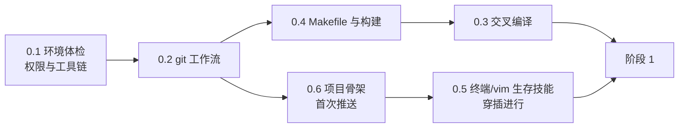

# 阶段 0 学习地图：工具链补课

> 按 [`docs/COLLABORATION.md`](../docs/COLLABORATION.md) §3 产出。
> **状态**：进行中 —— 0.1 ✅ 结课 ｜ 0.2.1 ✅ ｜ 0.2.2 ✅ ｜ **下一个：0.2.3 分支**
> **目标**：把工具链从「会用」变成「扎实」，为阶段 1 铺路——阶段 1 每次都要 commit、编译、调试，工具不熟会处处卡壳。

---

## 一、本阶段定位

阶段 0 不是"学 git 命令"，而是**建立三条工程肌肉记忆**：

| 肌肉记忆 | 为什么必须现在建立 |
|---------|------------------|
| **版本控制** | 阶段 1 会频繁改驱动代码、试错、回滚。没有 git 就只能靠"复制一份备份"，三天后必然混乱 |
| **构建能力** | 驱动和应用都要编译。不懂 Makefile 就只能照抄，出错了不知道怎么修 |
| **环境诊断** | 嵌入式开发 80% 的时间在做"排查为什么跑不起来"。要建立**分层定位**的思维（硬件→驱动→设备节点→API→应用） |

---

## 二、学习地图（6 个小节）



| # | 小节 | 核心问题 | 预计 | 依赖 |
|---|------|---------|------|------|
| **0.1** | 环境体检与权限 | 我的环境到底能不能干活？ | 30 min | — |
| **0.2** | git 工作流 | 代码改了怎么安全地回到过去？ | 3 h | 0.1 |
| **0.6** | 项目骨架与首次推送 | 怎么让代码离开这块板子？ | 30 min | 0.2 |
| **0.4** | Makefile 与构建 | 为什么改一个文件不用全部重编？ | 1.5 h | 0.2 |
| **0.3** | 交叉编译 | 为什么 x86 编的程序在板子上跑不了？ | 2 h | 0.4 |
| **0.5** | 终端与 vim 生存技能 | 怎么做到不碰鼠标改代码？ | 1 h | 穿插 |

**总计约 8.5 小时** ≈ 1 周碎片时间（按每天 1-1.5h 计）。

---

## 三、各小节内容

### 0.1 环境体检与权限（30 min）

**先做的理由**：环境问题会在后面**伪装成代码 bug**。比如摄像头打不开，你以为是 V4L2 用错了，其实是没有权限。

**要解决的问题**（2026-09-10 已实测出结论）：
1. 用户不在 `video` / `render` 组 → 摄像头和 NPU 都会 Permission denied
2. 确认交叉编译工具链在哪台机器、是否已装

**原理**：Linux 的 `/dev/*` 节点用 "属主+属组+权限位" 控制访问（对比 MCU：你直接操作寄存器，没有权限概念——这是 Linux 多用户设计带来的额外一层）。

**验收**：`groups` 含 `video,render`；`v4l2-ctl --list-devices` 不报权限错误。

---

### 0.2 git 工作流（3 h，拆 5 次）

**为什么先学 git**：后面每一步产出的代码都要提交。这是基础设施，不是可选项。

| 子节 | 学什么 | 关键原理 |
|------|--------|---------|
| 0.2.1 | 三层模型：工作区 / 暂存区 / 版本库 | **暂存区为什么存在**——它让你能"只提交一部分改动"，是 git 区别于"复制备份"的核心设计 |
| 0.2.2 | `init` / `add` / `commit` / `status` / `log` / `diff` | commit 存的是**快照**不是差异；每个 commit 是完整状态 |
| 0.2.3 | 分支：`branch` / `checkout` / `merge` | 分支只是一个**指向 commit 的指针**，创建分支几乎零成本 |
| 0.2.4 | 远程：`remote` / `push` / `pull` / `clone` | 分布式：本地库是完整的，远程只是另一个副本 |
| 0.2.5 | 撤销：`restore` / `reset` / `revert` 的区别 | reset 改历史（危险），revert 加新 commit 来抵消（安全） |

**与 MCU 经验类比**：git 的 commit 像你固件里的版本号 v1.0/v1.1，但强在——可以**并行开发多个特性**（分支）、可以**精确回退到任意一行改动**、可以**合并别人的修改**而不覆盖。

**验收**：能独立完成"改代码 → 查看差异 → 选择性提交 → 推送"的完整循环；能解释 `git reset --hard` 为什么危险。

---

### 0.6 项目骨架与首次推送（30 min）

**内容**：
- 确认 `stage0-toolchain/` ~ `stage3-ai/` 目录职责
- 确认 TF 卡数据目录约定（大文件不进 git）
- 检查 `.gitignore` 是否漏项
- 首次 `commit` + 推送到 GitHub 私有库

**验收**：GitHub 上能看到本仓库；`git log` 历史清晰（本项目已有 2 次提交）。

---

### 0.4 Makefile 与构建（1.5 h）

**为什么不能用 shell 脚本代替**：编译 20 个文件时，改 1 个文件要重编 1 个还是 20 个？make 靠**文件时间戳**自动判断，这是它的全部价值所在。

| 层次 | 内容 |
|------|------|
| 原理 | 依赖图（DAG）+ 时间戳比较；`目标: 依赖` 规则 |
| 基础 | 显式规则、变量、`$@` `$<` `$^` 自动变量 |
| 进阶 | 模式规则 `%.o: %.c`、`.PHONY`、`wildcard` |
| 实战 | 给多文件 Hello 项目写规范 Makefile |

**验收**：改一个 `.c` 文件，`make` 只重编那一个 `.o`（用 `make -n` 或观察输出验证）。

---

### 0.3 交叉编译（2 h）

**先讲原理（这里是坑最密集的地方）**：

> 交叉编译 = 在 A 架构的机器上，生成能在 B 架构上运行的程序。

三个必须理解的概念：
1. **工具链三件套**：`binutils`（链接器/汇编器）+ `gcc` + `libc`（目标平台的 C 库）
2. **sysroot**：交叉工具链自带的"目标平台根目录"，里面放着目标平台的库和头文件。**找不到库的 90% 原因是没有正确的 sysroot**
3. **动态链接器**：`No such file or directory` 这个报错，说的是**找不到 `/lib/ld-linux-aarch64.so.1`**，而不是你的程序不存在——这是最经典的误导性报错

**实操**：x86 主机写 Hello → `aarch64-linux-gnu-gcc` 编译 → `file` 确认架构 → scp 到板子 → 运行

**验收**：`file hello` 显示 `ELF 64-bit LSB, ARM aarch64`；板子上成功打印。

> ⚠️ **前置**：需确认 x86 主机（`lihaihui-virtual-machine`）上是否装了交叉工具链。若没装，本小节改为"在板端原生编译 + 讲解交叉编译原理"，实操延后。

---

### 0.5 终端与 vim 生存技能（1 h，穿插）

**不求精通，只求"够用"**：

| 技能 | 最低要求 |
|------|---------|
| vim | 能在 Normal / Insert 模式间切换；`dd` `yy` `p` `/` `:%s/old/new/g` `:wq` |
| 终端多路复用 | 用 tmux 或 VS Code 终端分屏，一边编译一边看 `dmesg -w` |
| 文本处理 | `grep -rn` 找符号、`find` 找文件、`tail -f` 跟日志 |

**验收**：在板子上用 vim 改一个文件并保存，全程不碰鼠标。

---

## 四、阶段 0 验收清单

全部打勾才能进阶段 1：

- [x] 用户已在 `video` / `render` / `dialout` 组；`v4l2-ctl --list-devices` 无权限错误
- [ ] 能独立完成 git 五步循环（改 → diff → add → commit → push）
- [ ] 能解释暂存区的作用、分支的本质、`reset --hard` 的风险
- [ ] 项目已推送到 GitHub 私有库
- [ ] 能看懂并写出带模式规则的 Makefile
- [ ] 交叉编译产物能在板子上运行（或已理解原理，实操延后）
- [ ] 能用 vim 改文件不碰鼠标
- [ ] `stage0-toolchain/` 下有练习产物 + 学习笔记

---

## 五、学习笔记放哪

每个小节结束后在 `stage0-toolchain/docs/` 下写一份笔记：

```
stage0-toolchain/
├── LEARNING-MAP.md          ← 本文件
├── docs/
│   ├── 0.2-git-notes.md
│   ├── 0.3-cross-compile-notes.md
│   └── 0.4-makefile-notes.md
├── practice/
│   ├── hello-gcc/           ← 原生编译练习
│   └── hello-cross/         ← 交叉编译练习
└── Makefile.exercise
```

笔记模板（三问）：
1. **这个工具解决什么问题？**（不是"它怎么用"）
2. **它的核心原理是什么？**（一句话能讲清）
3. **我踩了什么坑？**（现象 → 根因 → 解法，同步到 skill 的 knowledge-log）

---

## 六、进度与下一步

| 小节 | 状态 |
|------|------|
| 0.1 环境体检与权限 | ✅ **结课**（笔记：`docs/0.1-permission-notes.md`） |
| 0.2.1 三层模型 | ✅ 完成 |
| 0.2.2 命令与数据模型 | ✅ 完成 |
| 0.2.3 分支 | ⬜ **下一个** |
| 0.2.4 远程 / 0.2.5 撤销 | ⬜ |
| 0.3 交叉编译 / 0.4 Makefile / 0.5 终端 vim / 0.6 首次推送 | ⬜ |

**下一步：0.2.3 分支**，按五步法走：

1. 我讲原理（分支的本质 = 指向 commit 的指针）
2. 我定目标（验收标准）
3. 我给思路（命令清单与原因，不给可复制的完整脚本）
4. **你执行**
5. 我 review
