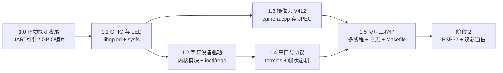
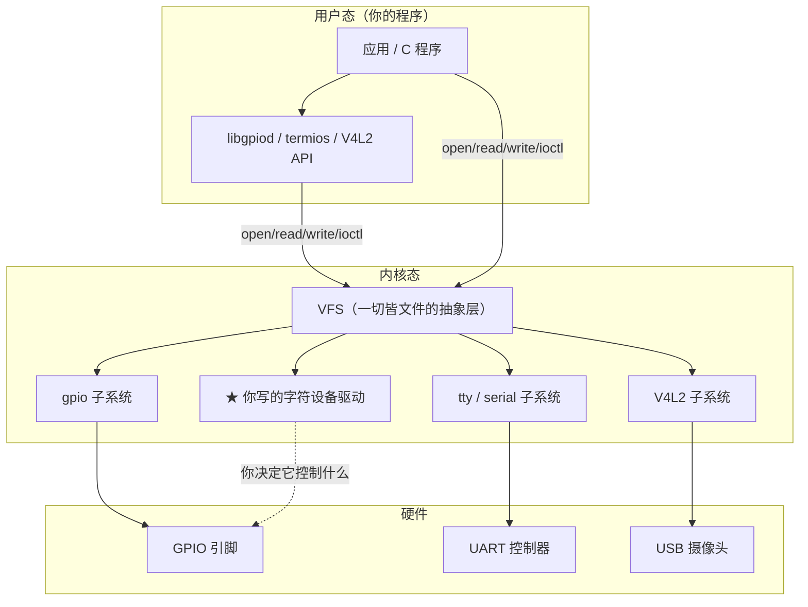

# 阶段 1 学习地图：RK3566 Linux 底层

> 按 [`docs/COLLABORATION.md`](../../docs/COLLABORATION.md) §3 产出 · 2026-09-20
> **状态**：待用户确认后开始 1.0
> **目标**：从"会用 Linux"到"能操作硬件 + 能写驱动"——打通 **用户态 ⇄ 内核态 ⇄ 硬件** 的完整链条。

---

## 一、本阶段定位

阶段 0 解决的是"**能不能干活**"（工具链、版本控制、编译部署）。
阶段 1 解决的是"**怎么和硬件打交道**"——这是嵌入式 Linux 的核心，也是你 MCU 经验最能平移的部分。

### 与 MCU 经验的对应关系

| MCU（你的舒适区） | Linux 对应的东西 | 阶段 1 小节 |
|---|---|---|
| 配置 GPIO 寄存器点亮 LED | `/dev/gpiochipN` + libgpiod / sysfs leds | 1.1 |
| 写 `USART_InitTypeDef` 初始化串口 | termios + `/dev/ttyS*` | 1.4 |
| 寄存器级写外设驱动 | **字符设备驱动**（内核模块） | 1.2 |
| 主循环 + 中断 + 标志位 | **多线程 + 环形缓冲 + 条件变量** | 1.5 |
| 读摄像头模块时序 | V4L2 框架（内核已封装） | 1.3 |

**一句话**：MCU 上你直接摸寄存器；Linux 上你隔着**内核**摸硬件——要么用内核已提供的接口（gpiod / tty / V4L2），要么自己写驱动把硬件"翻译"成文件接口。

---

## 二、与既有文档的差异说明（重要）

`docs/SPEC.md` §7 与 `docs/PLAN.md` 对阶段 1 的小节划分**不一致**：

| 文档 | 阶段 1 的划分 |
|------|--------------|
| `PLAN.md` | 1.1 GPIO/libgpiod → 1.2 字符驱动 → 1.3 UART → 1.4 多线程应用 |
| `SPEC.md` §7 | 1.1 环境探测 → 1.2 摄像头 → 1.3 串口 → 1.4 驱动 → 1.5 应用工程化 |

**本地图取并集并重排**，理由：

1. **补上环境探测**（SPEC 有、PLAN 漏）——UART 引针等遗留问题必须先清
2. **GPIO 放最前**（PLAN 有）——MCU 思维平移最直接，且能顺手解决 `/dev/gpiochip*` 权限问题
3. **驱动提前到第 3 位**——趁"底层"手感正热；且本节的驱动**不需要碰设备树**（见 1.2 说明），风险可控
4. **摄像头 / 串口按 SPEC 的 FR 优先级排在后面**——它们是 P0 交付物，但前置知识更多

---

## 三、学习地图（6 个小节）



| # | 小节 | 核心问题 | 交付物 | 预计 | 依赖 |
|---|------|---------|--------|------|------|
| **1.0** | 环境探测收尾 | 排针上到底引出了什么？ | 硬件清单（GPIO/UART 编号） | 30 min | — |
| **1.1** | GPIO 与 LED | 用户态怎么点灯/读引脚？ | LED 闪烁 demo + udev 规则 | 2 h | 1.0 |
| **1.2** | 字符设备驱动 | 驱动怎么把硬件变成文件？ | `edge_ai_evt.ko` + 测试程序 | 6 h（3 次） | 1.1 |
| **1.3** | 摄像头 V4L2 | 视频流怎么变成内存里的帧？ | `camera.cpp` 存下 JPEG | 4 h（2 次） | 1.1 |
| **1.4** | 串口与协议 | 字节流怎么变成可靠的消息？ | `serial.cpp` + `protocol.cpp` | 5 h（3 次） | 1.1 |
| **1.5** | 应用工程化 | 多个任务怎么安全并行？ | 多线程骨架 + 日志 + Makefile | 6 h（3 次） | 1.3、1.4 |

**总计约 23.5 小时** ≈ 3 周碎片时间（按每天 1-1.5h 计）。
SPEC 预估 4-6 周，本地图更紧凑——**遇到卡壳随时拉长，不用赶**。

---

## 四、各小节内容

### 1.0 环境探测收尾（30 min）

**要解决的问题（09-12 遗留）**：
- 10 个 UART 控制器只启用 2 个（`ttyS1` / `ttyS3`）——**哪个引到了排针**？
- 蓝牙 `hci0` 是否占用 `ttyS1`？
- 排针上引出了哪些 GPIO？（决定 1.1 能否实际操作）

**手段**：`/proc/device-tree/`、`gpioinfo`、原理图/丝印、`dmesg | grep uart`

**验收**：一页硬件清单（写进 `references/hardware.md`）

---

### 1.1 GPIO 与 LED（2 h）

**为什么先学**：MCU 上你天天点灯，这里是同一动作的 Linux 版本。且能顺手解决 `/dev/gpiochip*` 的权限问题。

**核心原理**：
- **GPIO 字符设备（`/dev/gpiochipN`）+ libgpiod**：新标准做法（取代旧的 `/sys/class/gpio`）
- **leds 子系统**：内核已有 LED 驱动时，直接写 `/sys/class/leds/*/brightness`（不必碰 GPIO）
- 两条路的本质区别：**"内核已经接管了这个硬件"** vs **"我要自己操作引脚"**

**实测环境（2026-09-20）**：

```
/dev/gpiochip0~4       root:root 600   ← ⚠️ 普通用户无权访问（且系统里【没有】gpio 组）
gpiochip0 [gpio0] 32 lines ... gpiochip4 [gpio4] 32 lines   （5 个 bank，各 32 引脚）
/sys/class/leds/       rgb-led-r / rgb-led-g / rgb-led-b（max_brightness=1）+ mmc0::
/proc/device-tree/     adc-keys（按键走 ADC，不是 GPIO）、leds
```

**要解决的新问题**：**系统里没有 `gpio` 组** → 只能写 **udev 规则**给 `/dev/gpiochip*` 改属组（0.1 权限模型的进阶应用）

**动手产出**：
- 用 **sysfs** 让板载 RGB LED 闪起来（有视觉反馈）
- 用 **libgpiod**（`gpioinfo` / `gpioget` / `gpioset`）操作 GPIO，用**回读**验证
- 写一条 **udev 规则**，让普通用户能用 GPIO
- （可选）写 C 程序调用 libgpiod 库

**验收**：不碰鼠标、不用 `sudo`，让 RGB LED 按指定顺序闪烁；`gpioinfo` 能看引脚占用

---

### 1.2 字符设备驱动（6 h，分 3 次）

**为什么是重头戏**：从用户态跨到内核态的一步，也是理解"一切皆文件"的最快路径。

**核心原理**：
- 内核模块生命周期（`insmod` / `rmmod` / `module_init` / `module_exit`）
- **`file_operations`**：把 `open/read/write/ioctl` 映射到你的函数
- **`copy_to_user` / `copy_from_user`**：跨越用户态/内核态边界（为什么不能直接解引用指针）
- 自动创建设备节点：`class_create()` + `device_create()`
- 阻塞 / 非阻塞 I/O 与 `poll`

**⚠️ 关键取舍：本小节的驱动不碰设备树**

1. 教学用事件队列驱动**不绑定具体硬件**，`register_chrdev` + `class_create` 就够了
2. **规避"改设备树 → 重编内核 → 烧录"的高风险链路**（烧错可能变砖、周期长）
3. 设备树的作用是"描述硬件并匹配 `platform_driver`"——留到真正需要时再学

> 📌 **编译方式：板卡上原生编译**（`/lib/modules/6.1.141/build` 存在，已实测 ✅），不需要交叉编译。

**分 3 次**：
1. 最小可加载模块（`insmod` 打印 hello / `rmmod` 打印 bye）
2. 加 `file_operations` + 自动创建 `/dev/edge_ai0`
3. 实现 ioctl 控制 + read 读事件队列 + 用户态测试程序

**验收**：`insmod edge_ai_evt.ko` 后 `/dev/edge_ai0` 自动出现；用户态能 ioctl 配置 + read 取数；`rmmod` 干净卸载

**对应 FR**：FR-28

---

### 1.3 摄像头 V4L2（4 h，分 2 次）

**为什么**：P0 需求（FR-20），也是阶段 3 AI 推理的数据源。

**核心原理**：
- V4L2 **缓冲队列模型**：QBUF / DQBUF 的配对（对应 K-004）
- `mmap` 零拷贝取帧
- 格式协商（`VIDIOC_S_FMT` / `VIDIOC_G_FMT`）；MJPEG vs YUYV 的带宽差异
- **绝不硬编码设备节点**（K-016）：摄像头在 `/dev/video10`，但要运行时校验

**实测前提**：摄像头 `b249:b081`，MJPG 640×480@30fps 稳态 30.23fps

**动手产出**：`camera.cpp` —— 打开 → 协商格式 → 申请缓冲 → 循环取帧 → 存一张 JPEG

**验收**：存下 640×480 JPEG 并能打开看到画面

**对应 FR**：FR-20

---

### 1.4 串口与协议（5 h，分 3 次）

**为什么**：P0 需求（FR-21/40/41/43），阶段 2 双芯通信的基础。C 语言在这节是主角。

**核心原理**：
- **termios**：串口配置（你配 `USART_InitTypeDef` 的 Linux 版本）
- **原始模式**（`cfmakeraw`）：关掉规范模式/回显/流控（K-002）
- **`poll` / `select` 多路复用**：同时等串口和其他事件
- **帧协议 + 状态机**：粘包/半包的本质（K-001），逐字节喂状态机
- **CRC16-CCITT**：算法与查表实现

**动手产出**：`serial.cpp` + `protocol.cpp` + 自环压测脚本

**验收**：**自环 1000 帧 0 误码**；注入随机字节后通信能自恢复

**对应 FR**：FR-21, FR-40, FR-41, FR-43

---

### 1.5 应用工程化（6 h，分 3 次）

**为什么**：把前面所有零件组装成能长期运行的应用（FR-25/26/29）——"从会写代码到会做产品"。

**核心原理**：
- **线程模型设计**：为什么采集与推理要解耦（环形缓冲）
- **无锁环形缓冲**：单生产者单消费者的经典结构
- **条件变量 + 优雅退出**：`SIGINT` 如何唤醒所有阻塞线程
- **异步日志**：落盘 I/O 为什么不能放在决策路径上
- **Makefile 工程化**：多目录多文件 + `-MMD` 依赖（复用 0.4 成果）

**动手产出**：`stage1-rk3566/apps/edge_ai_node/` 多线程骨架（采集/推理/串口/日志四线程）+ 分级日志 + Makefile

**验收**：`top -H` 多线程可见；`Ctrl+C` 后所有线程干净退出；连跑 1h 内存不涨

**对应 FR**：FR-25, FR-26, FR-29

---

## 五、原理总览：用户态 ⇄ 内核态 ⇄ 硬件



**这张图解释三件事**：

1. **为什么"一切皆文件"是 Linux 的核心设计**：不管背后是 GPIO、串口还是摄像头，用户态看到的都是 `open/read/write/ioctl`——**统一的接口，各异的实现**
2. **驱动在哪**：它在 VFS 下面，负责把"文件操作"翻译成"硬件动作"
3. **三条路线的区别**：
   - 用**内核已提供的子系统**（gpio / tty / V4L2）→ 学 API 就行
   - **自己写驱动**（DRV4）→ 难，但你能让任何硬件变成文件
   - 阶段 1 前三节走第一条路，1.2 走第二条路

**贯穿全程的三个核心概念**：

| 概念 | 一句话 | 首次出现 |
|------|--------|---------|
| **设备节点 = 硬件入口** | `/dev/xxx` 是硬件在用户态的门牌号 | 1.1 |
| **ioctl = 硬件专用命令** | read/write 不够用时，用 ioctl 传自定义指令 | 1.2 |
| **阻塞 vs 异步** | 没数据时"睡着等"还是"立刻返回"（`O_NONBLOCK` / `poll`） | 1.2、1.4 |

---

## 六、阶段 1 验收清单

全部打勾才能进阶段 2：

- [ ] 硬件清单完整：GPIO 编号、UART 引针、摄像头节点均经**实测**确认（不是查资料）
- [ ] 普通用户（非 root）能操作 GPIO —— 用 udev 规则解决权限
- [ ] 能独立写、编译、加载、卸载一个内核模块
- [ ] `edge_ai_evt.ko`：`insmod` 后 `/dev/edge_ai0` 自动出现，用户态可 ioctl + read
- [ ] 能解释"为什么跨用户态/内核态要 `copy_to_user`"
- [ ] `camera.cpp` 能存下 640×480 JPEG 并正常打开
- [ ] 串口自环 **1000 帧 0 误码**；注入随机字节后能自恢复
- [ ] 能画出帧解析状态机，并解释粘包/半包怎么处理
- [ ] 多线程应用：`top -H` 多线程可见，`Ctrl+C` 优雅退出
- [ ] 连续运行 1h：无崩溃、RSS 不增长
- [ ] `stage1-rk3566/` 下有驱动 + 应用 + 学习笔记

**阶段 1 结束时的可演示物**：一个多线程应用，能读摄像头、收发串口、写日志；外加一个自己写的字符设备驱动。

---

## 七、前置调研（1.0 要做完）

| # | 事项 | 影响 |
|---|------|------|
| 1 | 排针引出了哪些 GPIO / UART | 决定 1.1 能否实际接线操作 |
| 2 | 内核源码与编译环境是否还在（x86 虚拟机） | 决定设备树相关内容能否做（1.2 已规避，影响很小） |
| 3 | 板卡无 `gpio` 组 → udev 规则方案 | 1.1 的第一个任务 |

---

## 八、进度

| 小节 | 状态 | 日期 |
|------|------|------|
| 1.0 环境探测收尾 | ✅ **完成** | 2026-09-20 |
| 1.1 GPIO 与 LED | ✅ **结课**（笔记：`docs/1.1-gpio-notes.md`） | 2026-09-21 |
| 1.2 字符设备驱动 | ⬜ **下一个** | |
| 1.3 摄像头 V4L2 | ⬜ 未开始 | |
| 1.4 串口与协议 | ⬜ 未开始 | |
| 1.5 应用工程化 | ⬜ 未开始 | |

### ⏭️ 下次起点：1.2 字符设备驱动（6 h，分 3 次）

**准备就绪**：
- 编译环境：`/lib/modules/6.1.141/build` 存在 → **板卡上原生编译**，不需要交叉编译
- **不碰设备树**（规避"改设备树 → 重编内核 → 刷 boot 分区"的高风险链路）
- 第一次目标：**最小可加载模块**（`insmod` 打印 hello / `rmmod` 打印 bye）

按五步法走：1. 我讲原理 → 2. 我定目标 → 3. 我给思路 → 4. **你动手** → 5. 我 review

> 💬 若对顺序有异议（比如想先做摄像头、早点看到图像），**随时提出**——地图是可以改的，改在开始之前成本最低。
