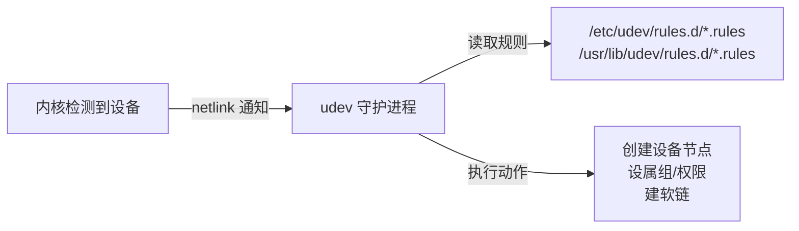

# 1.1 学习笔记：GPIO 与 LED

> 阶段 1 · 小节 1.1 · **结课 2026-09-21**（原理 09-20 + 实验 09-21）
> 相关：`references/hardware.md` §2.7（40PIN 引脚表）、`knowledge-log.md` K-029 / K-030 / K-031

---

## 一、从 MCU 点灯到 Linux 点灯：中间多了三层

**MCU（你的舒适区）**：

```c
RCC->AHB1ENR |= RCC_AHB1ENR_GPIOAEN;   // 开时钟
GPIOA->MODER |= (1 << 10);             // PA5 配为输出
GPIOA->BSRR  = (1 << 5);               // 置高
```

**Linux**：

```
┌──────────────────────────────────────────────────┐
│ 用户态  open("/dev/gpiochip3")                    │
│         ioctl(申请 line 1) / ioctl(设置电平)       │
└──────────────────┬───────────────────────────────┘
                   │ 系统调用
┌──────────────────▼───────────────────────────────┐
│ gpio 子系统      ← 谁在用这条线？权限够吗？        │
└──────────────────┬───────────────────────────────┘
┌──────────────────▼───────────────────────────────┐
│ pinctrl 子系统   ← 这个引脚的"身份"是什么？        │
└──────────────────┬───────────────────────────────┘
┌──────────────────▼───────────────────────────────┐
│ GPIO 控制器（硬件） ← 寄存器在这里                 │
└──────────────────────────────────────────────────┘
```

**为什么必须多这三层**：

| 原因 | 说明 |
|------|------|
| **① 硬件隔离** | 用户态**访问不到物理地址**（MMU 分隔地址空间），碰寄存器必须由内核代劳 |
| **② 资源统一管理** | 160 个 GPIO 是全系统共享资源，**必须仲裁"这个引脚归谁用"**，否则会和 UART 等驱动互相干扰 |
| **③ 权限控制** | `/dev/gpiochip*` 有属主属组，能否访问由文件权限决定（0.1 的知识） |

> **一句话**：MCU 上"引脚归你独占"，Linux 上"引脚是共享资源，要走审批流程"。

---

## 二、`pinctrl` vs `gpio`：两个子系统，两件事

| 子系统 | 管什么 | 关键词 |
|--------|--------|--------|
| **pinctrl** | 引脚的**身份**——此刻是 GPIO，还是 UART_TX / I2C_SCL？ | 复用（mux）、上拉/下拉、驱动能力 |
| **gpio** | GPIO 的**行为**——输入/输出？电平？中断触发方式？ | 方向、电平、中断 |

**1.0 探测看到的 `pinmux-pins` 就是 pinctrl 的视图**：

```
pin 111 (gpio3-15): fe670000.serial ... function uart3 group uart3m1-xfer
                     └─ 这个引脚的"身份"已分配给 uart3
```

**只有身份为 GPIO 的引脚，才在 gpio 子系统管辖范围内**（才会出现在 `/dev/gpiochipN`）。

> ⚠️ **这就是 K-029 的根因**：`gpioinfo` 只反映 gpio 子系统的视角。引脚被"改身份"给 UART 后，gpio 子系统根本不知道，所以显示 `unused`。

---

## 三、两套用户态接口：sysfs vs 字符设备

| | **A. sysfs（旧，已废弃）** | **B. 字符设备 + libgpiod（标准）** |
|---|---|---|
| 接口 | `/sys/class/gpio/gpio97/value` | `/dev/gpiochip3` + `ioctl` |
| 用法 | `echo 1 > value` | `gpioset gpiochip3 1=1` |
| **所有权** | ❌ 无——随时可能被别人抢 | ✅ `request` 成功即独占 |
| **原子性** | ❌ 存在竞态 | ✅ 原子操作 |
| 状态 | ⚠️ Linux 4.8 起标记 deprecated | ✅ 官方推荐 |

**sysfs 为什么被废弃**——经典的 **check-then-act 竞态**：

```
你的操作：① 检查引脚空闲 → ② 占用它 → ③ 设置方向
                ↑ 这两步之间，另一个进程可能把它抢走
```

字符设备接口把"申请"做成**一个原子操作**，申请成功就归你。

> 💡 网上大量 `echo 97 > /sys/class/gpio/export` 的老教程——**知道它是什么，但别学它**。
> 它还有个副作用：`export` 会改变**系统全局状态**，用完不 `unexport` 就一直留着。

---

## 四、LED 子系统：内核已经接管的硬件

板载 RGB LED **不在 `/dev/gpiochip*` 里**，走另一套：

```bash
echo 1 > /sys/class/leds/rgb-led-r/brightness    # 亮
echo 0 > /sys/class/leds/rgb-led-r/brightness    # 灭
```

**为什么内核要单独做 LED 框架**：

| 能力 | 说明 |
|------|------|
| **触发器（trigger）** | 让 LED 自动跟随事件闪——`mmc0::` 那个灯就是"磁盘活动"触发器驱动的，**不需要任何程序** |
| **统一接口** | 不管底层是 GPIO 还是 PWM，上层都是 `brightness` |
| **零代码** | 写文件即可控制，不用编译程序 |

**由此得出一条判断原则**：

> **内核已经接管的硬件，不要再通过 GPIO 去抢。**
> 抢的结果：要么失败（引脚被占），要么**破坏内核驱动功能**。

**两条路对比**：

| | LED 子系统 | GPIO 字符设备 |
|---|---|---|
| 谁管硬件 | 内核 LED 驱动 | **你**（经 gpio 子系统） |
| 能做什么 | 写 `brightness` | 申请 line、方向、电平、中断 |
| 适合 | LED、按键、蜂鸣器（标准外设） | 自定义电路、传感器、非标准时序 |
| 自由度 | 低 | 高（**责任也自负**） |

---

## 五、udev：设备节点的"出生登记处"

**根本问题**：`/dev/video10` 的属组 `video` 是谁设的？

**是 udev。**



**规则语法**：

```
SUBSYSTEM=="gpio", KERNEL=="gpiochip*", GROUP="gpio", MODE="0660"
    │                  │                   │            │
 匹配子系统         匹配设备名           设属组       设权限
```

**读作**：「gpio 子系统里出现 `gpiochip*` 设备时，属组设为 `gpio`、权限设为 `0660`。」

**解决 GPIO 权限 = 两步配合**：

| 步骤 | 做什么 | 类比 |
|---|---|---|
| ① **udev 规则** | 设备节点**出生时就带正确属组** | 上户口 |
| ② **加入该组** | 你成为该组成员 | 拿门禁卡 |

> 💡 **验证理解**（可选）：
> ```bash
> grep -rn 'GROUP="video"' /usr/lib/udev/rules.d/ | head
> grep -rn "dialout" /usr/lib/udev/rules.d/ | head
> ```
> 看到那几行就会明白：**权限不是魔法，是配置。**

---

## 六、MCU 经验对照总结

| MCU 世界 | Linux 世界 | 差异根源 |
|---|---|---|
| `GPIOA->MODER = ...` | `gpioset`（libgpiod） | 用户态碰不到寄存器 |
| `RCC->AHB1ENR` 开时钟 | 内核已做好 | 时钟/电源统一管理 |
| 引脚**默认就是 GPIO** | 引脚**默认可能被复用成别的功能** | 引脚要"申请身份" |
| 一个引脚归你独占 | 引脚是**全系统共享资源** | 需要所有权仲裁 |
| 没有权限概念 | `/dev/gpiochip*` 有属主属组 | 多用户 OS 的代价 |

> **最需要转变的观念**：
> **"我能不能用这个引脚"在 Linux 里不是技术问题，而是"权限 + 所有权"问题。**
> 这就是为什么 1.1 的第一个任务不是写代码，而是**配 udev 规则**。

---

## 七、实验待验证的问题（下次做）

| # | 动作 | 要验证什么 |
|---|------|-----------|
| 1 | 写 udev 规则 | 设备节点属组是怎么来的；`udevadm` 怎么重载规则 |
| 2 | `sysfs` 点亮板载 RGB LED | LED 子系统（内核已接管的硬件） |
| 3 | `libgpiod` 操作**排针 11（`gpiochip3:1`）** + **回读验证** | GPIO 字符设备的所有权与原子操作 |
| 4 | 对比已废弃的 sysfs gpio | 为什么旧接口被淘汰 |

---

## 八、实验记录（2026-09-21）✅ 全部完成

### 动作 1 · udev 规则解决权限

规则文件 `/etc/udev/rules.d/99-gpiochip.rules`：

```
SUBSYSTEM=="gpio", KERNEL=="gpiochip*", GROUP="gpio", MODE="0660"
```

**首次失败**：权限 `600 → 660` 生效了，但**属组仍是 `root`**

- 根因：**`gpio` 组不存在** → udev **静默忽略** GROUP，只记一行日志：
  ```
  systemd-udevd: /etc/udev/rules.d/99-gpiochip.rules:1 Unknown group 'gpio', ignoring
  ```
- 解决：`groupadd gpio` → `usermod -aG gpio lihaihui` → `udevadm control --reload-rules` → `udevadm trigger`
- 结果：`crw-rw---- 1 root gpio 254, 3 /dev/gpiochip3` ✅ 免 sudo 可用
- ⚠️ **`newgrp gpio` 只影响当前 shell**；VS Code 分屏新开的终端不继承（表现为 `Permission denied`）→ 需重启 VS Code Server / 重连才能永久生效
- → 详见 **K-030**

### 动作 2 · sysfs 点亮板载 RGB LED

```bash
echo 1 | sudo tee /sys/class/leds/rgb-led-r/brightness    # 亮
echo 0 | sudo tee /sys/class/leds/rgb-led-r/brightness    # 灭
```

**两个"为什么"**：

| 问题 | 答案 |
|---|---|
| **为什么必须 `sudo`？** | LED 在 `/sys` 下，而 **udev 只管 `/dev`，不管 sysfs**。`brightness` 是 `root:root 644`，权限由驱动创建时决定，**无法用 udev 规则改** |
| **为什么用 `\| sudo tee` 而不是 `sudo echo >`？** | 重定向由当前 shell 执行，`sudo` 只作用于 `echo`（0.2.5 的坑） |

### 动作 3 · ★ trigger 机制（最"震撼"的一步）

```bash
echo heartbeat | sudo tee /sys/class/leds/rgb-led-r/trigger
```

**LED 自己按心跳节奏闪，而没有任何用户态程序在运行** ✅

- `cat trigger` 输出里的 **`[方括号]` = 当前激活的触发器**
- 支持的触发器：`none / timer / heartbeat / mmc0 / cpu0-3 / default-on / rfkill-* / kbd-*`
- **本质**：内核的 trigger 机制在驱动 LED（heartbeat 用内核定时器）——**"内核已经接管硬件"的最好例证**

### 动作 4 · libgpiod 与"所有权"

```bash
# 终端 A：申请并占住
gpioset --mode=wait gpiochip3 1=1

# 终端 B：观察
gpioinfo gpiochip3 | grep "line   1:"
        line   1:  unnamed  "gpioset"  output  active-high [used]     ← ★ 占用者 + [used]

# 终端 B：抢线
gpioget gpiochip3 1
gpioget: error reading GPIO values: Device or resource busy          ← ★ 所有权生效

# A 退出后
        line   1:  unnamed     unused  output  active-high            ← 已释放
```

**两个重要理解**：

1. 所有权粒度 = **单条 line**（line 1 被占，line 2 依然自由可申请）
2. ⚠️ **`Ctrl+C` 强杀时方向不重置**（退出后仍是 `output`）→ **异常退出可能残留引脚状态**

### 动作 5 · ★★ 电平传递验证（杜邦线）

**接线**：排针 **11**（`GPIO3_A1`，输出）↔ 排针 **13**（`GPIO3_A2`，输入）

```bash
# 终端 A
gpioset --mode=wait gpiochip3 1=1     # 输出高
# 终端 B
gpioget gpiochip3 2                    # → 稳定读到 1 ✅

# 终端 A 改写 0
gpioset --mode=wait gpiochip3 1=0
# 终端 B
gpioget gpiochip3 2                    # → 稳定读到 0 ✅
```

**完整链路被证明**：

```
你的程序 → /dev/gpiochip3 → gpio 子系统 → pinctrl → 排针 11 →（杜邦线）→ 排针 13 → 另一个程序
```

**副产品：浮空判据**（实验中拔掉杜邦线意外验证）

- 拔线后读数在 1/0 之间**随机跳变** → 引脚**悬空**
- **「稳定 = 有驱动源；跳变 = 悬空」** —— GPIO 输入最经典的判据

### 概念总结：两个层次的机制对比

| 机制 | 所在层 | 管什么 | 能否防冲突 |
|---|---|---|---|
| **GPIO 所有权**（`request`） | gpio 子系统 | 谁在用这条 line | ✅ 防**同层**竞争（两个 gpiod 程序） |
| **引脚复用占用** | pinctrl 子系统 | 引脚的"身份"归谁 | ❌ 管不了**跨层**冲突（程序 vs UART 驱动） |

> **这就是 K-029 的深层原因**：判断引脚能否使用必须查 **pinctrl**（`pinmux-pins`），
> 因为 gpio 子系统的视图（`gpioinfo`）看不到 pinctrl 层的占用。

### 遗留 / 待补

- ⚠️ **LED 状态还原**：`trigger` 开机默认是 `[timer]`（红灯呼吸效果）。
  **教训：改 sysfs 前先 `cat` 存档**（→ K-031）
- ⬜ 未做：对比已废弃的 sysfs gpio（`/sys/class/gpio/export`）——非关键路径，可跳过
- ⬜ 每次开新终端都要 `newgrp gpio`（或重启 VS Code Server 永久解决）

**已知条件**：

| 项 | 值 |
|---|---|
| 目标引脚 | 排针 11 = `GPIO3_A1` = 全局 97 = **`gpiochip3` line 1** |
| libgpiod | ✅ 已装（`gpioinfo` / `gpioget` / `gpioset`） |
| 板载 LED | `/sys/class/leds/rgb-led-{r,g,b}/brightness`（`max_brightness=1`） |
| 待解决问题 | `/dev/gpiochip*` 是 `root:root 600`，且系统**无 `gpio` 组** → 要新建组 + 写 udev 规则 |
| 难题 | 排针 11 无外接元件，**如何验证"点亮"**？→ 回读或（有杜邦线时）用另一条 GPIO 读 |
