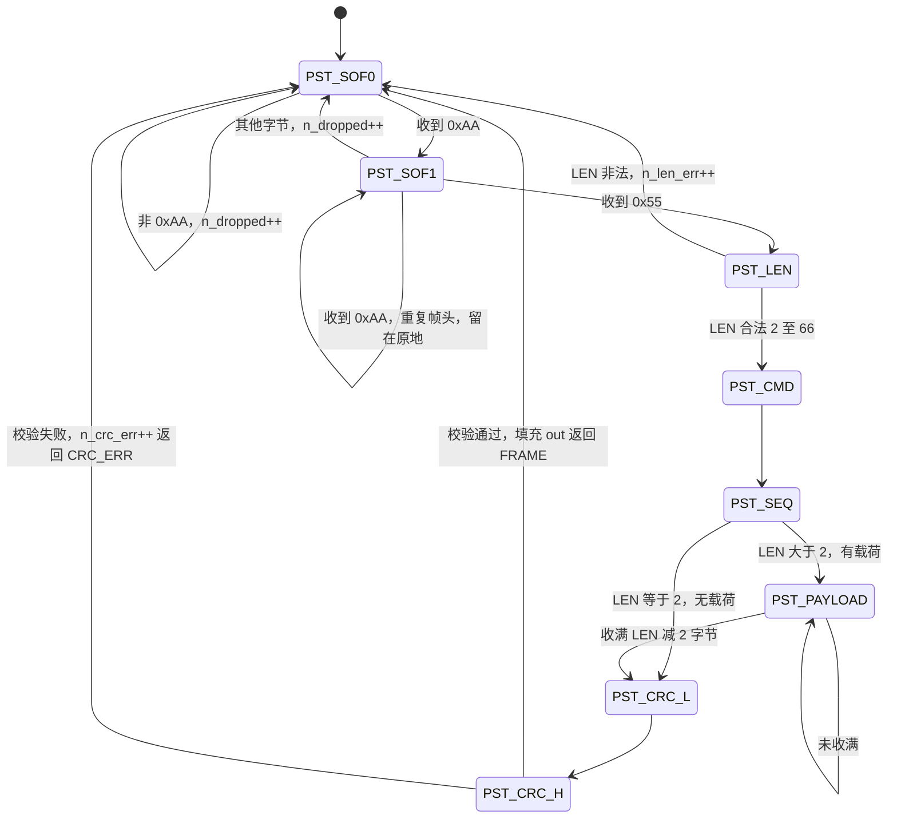

# 1.4 学习笔记：串口与协议

> 阶段 1 的第四个单元。目标：**掌握 Linux 串口编程 + 实现双芯通信的帧协议**
> （对应 `SPEC.md` FR-21 / FR-40 / FR-41 / FR-43）
>
> 开始日期：2026-10-08

---

## 〇、本单元的实施环境前提（2026-10-08 实测）

**结论：手上只有 RK3566 + 摄像头也足够做完整单元** —— 因为**板卡的 UART 支持芯片内部回环**，不需要外部导线。

| 需要的东西 | 本单元是否需要 | 状态 |
|-----------|--------------|------|
| RK3566 板卡 | ✅ 必需 | 已有 |
| USB 摄像头 | ❌ 本单元用不到 | 已有 |
| **外部导线（杜邦线）** | ❌ **不需要** | 用 `TIOCM_LOOP` 内部回环替代 |
| **ESP32** | ❌ 阶段 2 才需要 | — |
| **万用表** | ❌ 阶段 2 接外部设备时才需要 | — |

---

## 一、环境探测（2026-10-08）

### 1.1 板卡上有哪些串口

```bash
$ ls -l /dev/ttyS*
crw-rw---- 1 root dialout 4, 65 Jul 29 21:41  /dev/ttyS1
crw-rw---- 1 root dialout 4, 67 Jul 29 21:41  /dev/ttyS3
```

**只有两个**（`ttyS0`/`ttyS2` 不存在 —— 板卡只引出了这两个 UART）。

```bash
$ sudo cat /proc/tty/driver/serial
serinfo:1.0 driver revision:
1: uart:16550A mmio:0xFE650000 irq:35 tx:52304 rx:2447 RTS|CTS|DTR
3: uart:16550A mmio:0xFE670000 irq:36 tx:0     rx:0     CTS
```

**这张表信息量很大**：

| ttyS | tx / rx | 说明 |
|------|---------|------|
| **1** | 52304 / 2447 | **Bluetooth 在用**（所以 1.0 时就发现它被占用） |
| **3** | **0 / 0** | ⭐ **从开机到现在一个字节都没收发过 → 干净、可独占** |

**其他有用信息**：
- `uart:16550A` —— 8250 兼容芯片。**这个很关键**：它意味着**支持 `TIOCM_LOOP` 内部回环**（见 §1.3）
- `base_baud = 1500000`（来自 dmesg）—— 时钟有余量，115200 完全没问题

**权限**：`root:dialout 660`，而用户在 `dialout` 组里（1.1 加的）→ **不需要 `sudo`**。

### 1.2 ⭐ 亲眼看看内核默认配置有多少"陷阱"

```bash
$ stty -F /dev/ttyS3 -a
speed 9600 baud; ...
-parenb -parodd -cmspar cs8 hupcl -cstopb cread clocal -crtscts
-ignbrk -brkint -ignpar -parmrk -inpck -istrip -inlcr -igncr icrnl ixon -ixoff ...
opost -olcuc -ocrnl onlcr -onocr -onlret -ofill -ofdel ...
isig icanon iexten echo echoe echok ...
```

**逐项翻译**：

**✅ 好消息 —— 硬件参数默认就是对的**：

| 项 | 值 | 对应 8N1 |
|---|---|---|
| `cs8` | 8 数据位 | ✅ |
| `-cstopb` | 1 停止位 | ✅ |
| `-parenb` | 无校验 | ✅ |
| `cread` | 使能接收 | ✅ |
| `clocal` | 忽略 modem 控制线 | ✅ |
| `-crtscts` | 硬件流控已关 | ✅ |

**⚠️ 坏消息 —— 软件层的"中间人"全部开着**：

| 开着的选项 | 在哪一组 | 危害 |
|-----------|---------|------|
| **`icrnl`** | c_iflag | 输入的 `0x0D` 被改成 `0x0A` → **帧内容被篡改** |
| **`ixon`** | c_iflag | 软件流控：`0x11`/`0x13` 被吞掉 → **数据静默丢失** |
| **`opost` + `onlcr`** | c_oflag | 输出的 `0x0A` 被扩成 `0x0D 0x0A` → **帧长度都变了** |
| **`isig`** | c_lflag | 收到 `0x03` → **内核给进程发 SIGINT，直接杀掉** |
| **`icanon`** | c_lflag | 输入被**攒着**，直到遇到 `\n` 才交给应用 → **收帧完全卡死** |
| **`echo`** | c_lflag | 收到的数据自动回显 |

**⚠️ 还有一个数字**：`speed 9600` —— **默认不是 115200**。不改的话收到的是乱码（且不报错）。

### 1.3 ⭐ 内部回环可用 —— 不需要任何导线

**原理**：8250 系列 UART 的 **MCR 寄存器**有一个 `LOOP` 位。置位后，**芯片内部把 TX 直接接回 RX**，完全不需要外部连线。

**用户态接口**：`ioctl(fd, TIOCMBIS, &TIOCM_LOOP)`

**实测结果**（`serial_probe.c`）：

```
TIOCM_LOOP 设置成功，现在发什么应该就能收回什么
已发出 5 字节: [HELLO]
✅ 读回 5 字节: [HELLO]
✅ 内容完全一致 —— 内部回环可用！
```

**⭐ 意义**：本单元的"1000 帧 0 误码"验收**可以在这块板子上直接完成**，不需要等外部导线。

---

## 二、🚨 Linux 串口的第一道坎：TTY 层会篡改你的数据

> 这一节是 1.4 最重要的原理。**不理解它就写不出能用的串口程序。**

### 2.1 先回忆：你在 MCU 里怎么用串口

```c
UART_Init(&huart, 115200, 8, 1, NONE);     // 配参数
HAL_UART_Transmit(&huart, buf, len);        // 发
HAL_UART_Receive(&huart, buf, len);         // 收
```

**特点**：`buf` 里的字节，**发出去是什么，对方就收到什么**。中间没有任何东西会"帮你改一下"。

### 2.2 Linux 里多了一层"中间人"

在 Linux 里：

```c
write(fd, buf, len);
read(fd, buf, len);
```

**但是**，在"你的代码"和"UART 硬件"之间，内核插了一层软件：

```
你的代码  →  【TTY 层】  →  UART 驱动  →  硬件引脚
              ↑
        这一层会"处理"你的数据
```

**为什么要有这一层？**

因为 Unix 里串口的**第一个用途是连接终端**（键盘 + 显示器）。为了支持终端，内核必须做这些事：

- 你敲 `a`，屏幕上要**显示**出来（回声）
- 你敲退格键，要**删掉**前一个字符
- 你敲 `Ctrl+C`，要**中断当前正在跑的程序**
- 一行还没敲完（没按回车）时，程序**不应该收到**

**这些"终端行为"就是 TTY 层做的事，默认全部开启。**

### 2.3 五个真实的数据篡改案例

**关键**：TTY 层**分不清**你是在敲键盘，还是在传二进制协议帧。它**一律按终端的方式处理**。

#### 案例 1：你发一个 `0x0A`（换行）

```c
char c = 0x0A;
write(fd, &c, 1);      // 你以为发了 1 个字节
```

**实际发出去 2 个字节**：`0x0D 0x0A`。

**原因**：`ONLCR`（Output NewLine → Carriage Return）默认开着，看到 `\n` 就自动补一个 `\r` —— 因为终端需要"回车 + 换行"两个动作。

**后果**：帧长度变了 → 对方按 LEN 字段解析 → **整个协议错位**。

#### 案例 2：你收到一个 `0x0D`（回车）

对方帧里有个字节是 `0x0D`。你 `read` 出来，**变成了 `0x0A`**。

**原因**：`ICRNL`（Input Carriage Return → NewLine）默认开着。

**后果**：**帧内容被改了** → CRC 校验必然失败，而你会以为是"CRC 算法写错了"。

#### 案例 3：你的数据里有 `0x03`

`0x03` 是 `Ctrl+C` 的 ASCII 码。

**你的程序正在安静地读串口，突然被杀了。**

**原因**：`ISIG`（Signal Generation）默认开着 —— 内核看到这个控制字符，就**给前台进程发 SIGINT**。

**后果**：程序莫名退出，而且你不知道为什么（因为 `0x03` 只是帧里一个普通字节）。

#### 案例 4：你发了 10 个字节，对方一个都没收到

**原因**：`ICANON`（Canonical Mode，规范模式）默认开着 —— 内核**把收到的数据先攒起来**，直到看见行结束符才交给应用。

**后果**：帧不完整就一直不交 → **通信完全卡死**。

#### 案例 5：数据里有 `0x11` 或 `0x13`

`0x11` = `Ctrl+Q`，`0x13` = `Ctrl+S`。在终端里这俩是**软件流控**（暂停/继续）。

`IXON` 默认开着 → **这两个字节被内核直接吃掉**。

**后果**：如果 LEN 字段恰好是 `0x11`（17），或 CRC 里含这两个值 → **数据静默丢失，没有任何错误提示**。

### 2.4 `cfmakeraw()` —— 一行关掉所有终端行为

**我们要的是"裸模式"（raw mode）**：内核**什么都不做**，`write` 的字节原样出去，`read` 的字节原样进来。

**手动逐项关要写十几行**：

```c
tio.c_lflag &= ~(ICANON | ECHO | ECHOE | ISIG);
tio.c_iflag &= ~(ICRNL | INLCR | IXON | IXOFF | IGNBRK);
tio.c_oflag &= ~OPOST;
```

**所以标准库提供了封装**：

```c
cfmakeraw(&tio);      /* 一行，等于上面全部 */
```

**名字含义**：`cf` = configure，`makeraw` = make **raw**。

> **"raw"（生）是相对 "cooked / canonical"（熟）说的**：
> - **熟模式**：给终端用，内核帮你做各种润色
> - **生模式**：给数据通信用，内核一个字节都不碰

**⭐ 一句话总结**：

> **Linux 因为串口要当"终端"用，在中间插了一层会篡改数据的软件。做二进制协议时必须用 `cfmakeraw()` 把它关掉。**
> **MCU 里从来没这个问题，因为 MCU 的 UART 驱动没有这一层。**

---

## 三、`termios` 完整用法

### 3.1 结构体：只有 `c_cflag` 是你熟悉的东西

```c
struct termios {
    tcflag_t c_iflag;    /* 输入标志（ICRNL、IXON…）—— 全是"终端语义" */
    tcflag_t c_oflag;    /* 输出标志（ONLCR…）    —— 同上 */
    tcflag_t c_cflag;    /* ⭐ 控制标志：波特率/数据位/停止位/校验 ← 对应 USART_InitTypeDef */
    tcflag_t c_lflag;    /* 本地标志（ICANON、ECHO、ISIG）—— 同上 */
    cc_t     c_cc[NCCS]; /* 控制字符表（哪个字节算 Ctrl+C…）—— 同上 */
};
```

| termios 字段 | STM32 对应物 |
|-------------|-------------|
| `c_cflag` 的波特率/数据位/停止位/校验 | **`USART_InitTypeDef`**（一一对应） |
| `c_iflag` / `c_oflag` / `c_lflag` / `c_cc` | **没有对应物** —— 纯粹是 Linux 终端的"软件层历史包袱" |

**结论**：**你只需要关心 `c_cflag`**，其余全部交给 `cfmakeraw()` 一键清零。

### 3.2 标准配置模板

```c
int fd = open("/dev/ttyS3", O_RDWR | O_NOCTTY);   /* ⚠️ O_NOCTTY 别漏 */
struct termios tio;
tcgetattr(fd, &tio);               /* 先读出现有配置（必须，不能凭空造） */
cfmakeraw(&tio);                   /* ⭐ 一键清成裸模式 */
cfsetispeed(&tio, B115200);        /* 输入波特率 */
cfsetospeed(&tio, B115200);        /* 输出波特率 */
tio.c_cflag |=  (CLOCAL | CREAD);  /* 忽略 modem 控制线 + 使能接收 */
tio.c_cflag &= ~CRTSCTS;           /* ⚠️ 关硬件流控 */
tio.c_cflag &= ~CSTOPB;            /* 1 个停止位 */
tio.c_cflag &= ~PARENB;            /* 无校验 */
tio.c_cflag &= ~CSIZE;             /* 先清空数据位字段…… */
tio.c_cflag |=  CS8;               /* ……再设 8 位 */
tcsetattr(fd, TCSANOW, &tio);      /* 立即生效 */
tcflush(fd, TCIOFLUSH);            /* 清掉驱动里残留的数据 */
```

### 3.3 两个必须记住的坑

| 项 | 为什么 |
|----|--------|
| **`O_NOCTTY`** | 不加它，串口会变成你的"控制终端" → 对端发个 `0x03` 就把你进程杀了 |
| **`~CRTSCTS`（关硬件流控）** | 若开着流控但**没接 RTS/CTS 线**，UART 会认为"对方没准备好"，**一个字节都发不出去**。现象是"程序没报错，就是收不到数据" |

**⭐ 为什么 `CSIZE` 要先清再设**：`CSIZE` 是**两位**的字段（`CS5`/`CS6`/`CS7`/`CS8` 是取值 0~3），不是单个位。所以必须先清零再或上目标值。**这和你配 STM32 的 `USART_WordLength`（枚举赋值）不同**。

### 3.4 ⭐ TTY 配置是"设备状态"，跨进程持久

**现象**：第一次跑 `serial_probe` 时，"配置前"显示一堆 `1` + `9600`；**第二次跑，"配置前"变成了全 `0` + `115200`**。

**原因**：`tcsetattr()` 改的是**内核里这个 tty 对象的状态**（`tty_struct`），**不是进程状态**。

```
你的进程                     内核
┌──────────────┐         ┌──────────────┐
│ serial_probe │─tcsetattr─►│  ttyS3 的状态 │  ← 改的是这里
└──────────────┘         └──────────────┘
      │ 退出
      ▼
   进程没了，但 ttyS3 的状态【还在】
```

**`close(fd)` 只是"我不用了"，不会恢复配置。**

| 第几次跑 | "配置前"读到什么 |
|---------|----------------|
| 第 1 次 | 开机默认（9600 + 一堆终端行为开着） |
| 第 2 次起 | **上一次程序留下的状态** |

**⚠️ 实际后果**：如果程序被 `kill -9` 或崩溃，串口就**永远留在裸模式**。之后用 `screen`/`minicom` 连它调试会觉得"行为很怪"（没回显、Ctrl+C 不工作）。

**✅ 解决（已加入 `serial_probe.c`）**：

```c
/* 进程序时存一份 */
struct termios orig_tio;
tcgetattr(fd, &tio);
orig_tio = tio;                  /* 保存原始配置 */

/* ……干活…… */

/* 退出前还回去 */
tcsetattr(fd, TCSANOW, &orig_tio);
```

**⭐ 实测闭环**：手工 `stty sane` 恢复默认 → 跑程序（读到默认、改、用完恢复）→ **再跑，又读到默认** ✅

> **注意**：上面只覆盖了"正常退出"。**如果被 `kill -9`，仍需 `stty sane` 手动恢复**。

---

## 四、CRC-16/CCITT-FALSE

### 4.1 CRC 是干什么的

**一句话**：检测一串数据在传输中**有没有被改变**（某几个 bit 翻转了）。

**对比你熟悉的"简单校验和"**（字节全加起来取低 8 位）：

```c
uint8_t sum = 0;
for (i = 0; i < len; i++) sum += data[i];
```

**问题**：两个字节**位置调换**了，和不变 → 检测不出来。

```
数据 A: 0x01 0x02   → sum = 0x03
数据 B: 0x02 0x01   → sum = 0x03   ← 一模一样
```

**CRC 对位置敏感**，顺序变了结果就变。

| 能检出的错误类型 | 简单和 | CRC-16 |
|----------------|--------|--------|
| 单个 bit 翻转 | ✅ | ✅ |
| 任意**两个** bit 翻转 | ❌ 常漏 | ✅ |
| **奇数个** bit 翻转 | ❌ 常漏 | ✅ |
| **突发错误**（连续 ≤16 bit） | ❌ | ✅ **100%** |
| 更长的突发错 | ❌ | `1 - 2^-16` ≈ 99.998% |

### 4.2 原理：模 2 除法

**核心想法**：把整段数据当成一个超级大的二进制数，除以一个约定的"除数"，**取余数当校验码**。

**关键：这里的除法是特殊的**（"模 2 除法"，数学上叫 GF(2) 上的多项式除法）：

1. **没有进位，没有借位**
2. **加减法全部等于 XOR**

所以整个长除法里**只会看到 XOR 和移位**。

### 4.3 逐位算法：用"移位寄存器"理解

想象一个 **16 位的窗口**。**每来一个字节，做 8 次同样的动作**：

```
动作 A：看寄存器最高位是 0 还是 1
动作 B：整个寄存器左移 1 位
动作 C：如果刚才最高位是 1 → 把寄存器 XOR 上多项式
        （如果是 0 → 什么都不做）
```

**⭐ 为什么这样等于做除法**：
- **"最高位是 1 就 XOR"** = 长除法里"这一位够除，做一次减法"
- **"左移"** = 把下一位拉进来对齐
- 处理完全部位数后，寄存器里剩下的就是余数

**完整代码（只有 6 行核心）**：

```c
uint16_t crc16_bitwise(const uint8_t *data, size_t len)
{
    uint16_t crc = 0xFFFF;                   /* 初始值（变体规定） */

    for (size_t i = 0; i < len; i++) {
        crc ^= (uint16_t)(data[i] << 8);     /* 把字节异或进寄存器高 8 位 */

        for (int bit = 0; bit < 8; bit++) {
            if (crc & 0x8000) {              /* 最高位是 1？ */
                crc = (uint16_t)((crc << 1) ^ 0x1021);
            } else {
                crc = (uint16_t)(crc << 1);
            }
            crc &= 0xFFFF;                   /* ⚠️ 只保留 16 位，否则结果全错 */
        }
    }
    return crc;
}
```

**三个容易写错的点**：
1. **初始值不是 0**，而是 `0xFFFF`（变体规定）
2. **`crc ^= data[i] << 8`** 是异或到**高** 8 位，不是低 8 位
3. **`crc &= 0xFFFF`** 不能漏 —— 左移后产生第 17 位，必须丢掉

### 4.4 参数（`SPEC.md` §5.1 定死）

| 参数 | 值 | 含义 |
|------|-----|------|
| **多项式** | `0x1021` | 对应 x¹⁶ + x¹² + x⁵ + 1 |
| **初始值** | `0xFFFF` | 寄存器从全 1 开始 |
| **输入反转** | 否 | 字节不按位倒序 |
| **输出反转** | 否 | 结果不按位倒序 |
| **输出异或** | `0x0000` | 不做额外异或 |
| **校验值** | **`0x29B1`** | ⭐ **权威基准**（用 `"123456789"` 算出的） |

**⭐ `0x29B1` 是黄金标准**：全世界所有 `CRC-16/CCITT-FALSE` 实现，用 `"123456789"` 算都必须得到这个值。**算不出来就是错的**，不用怀疑别的地方。

**多项式为什么只写 16 位（`0x1021`）**：`x¹⁶` 那一项是"隐含的最高位"，在所有 CRC 实现里都不参与异或，所以业界约定只写低 16 位。

**关于 "FALSE" 这个名字**：CRC-16 有一堆变体（KERMIT、X-25、XMODEM、CCITT-TRUE…），区别就是上面那 5 个参数不同。`CCITT-FALSE` 只是其中之一，名字里的 "FALSE" 是历史遗留，没什么深意。

### 4.5 查表法（快 8 倍）

**核心思想**：把"处理一个字节要做的 8 次循环"**预先算好**存进表里。

```c
/* 建表：对每个可能的字节值 (0~255)，单独跑一遍逐位算法 */
static void build_crc_table(void)
{
    for (int i = 0; i < 256; i++) {
        uint16_t crc = (uint16_t)((uint16_t)i << 8);   /* 假设字节是 i */

        for (int bit = 0; bit < 8; bit++) {            /* 和逐位版一字不差 */
            if (crc & 0x8000)
                crc = (uint16_t)((crc << 1) ^ CRC16_POLY);
            else
                crc = (uint16_t)(crc << 1);
            crc &= 0xFFFF;
        }
        crc_table[i] = crc;                            /* 存下来 */
    }
}

/* 用表：一行代替 8 次循环 */
uint16_t crc16_table(const uint8_t *data, size_t len)
{
    if (!table_ready) build_crc_table();      /* 懒初始化 */

    uint16_t crc = 0xFFFF;
    for (size_t i = 0; i < len; i++) {
        uint8_t look = (uint8_t)((crc >> 8) ^ data[i]);      /* 决定查哪一项 */
        crc = (uint16_t)((crc << 8) ^ crc_table[look]);      /* 一次做完 8 轮 */
    }
    return crc;
}
```

**关键理解**：**建表函数的内层 8 行，和逐位实现的内层循环一字不差**。
差别只在：逐位法用**真实数据字节**，建表用"**假设字节是 `i`**"，单独跑一遍存下来。

**`look` 下标的来历**：
- `crc >> 8` = 取 CRC 的**高 8 位**（"当前正在处理、还没算完的部分"）
- `^ data[i]` = 异或新字节，**效果等价于逐位版的 `crc ^= data[i] << 8`**

**为什么用"懒初始化"（第一次调用时才建表）**：

| 方案 | 优点 | 缺点 |
|------|------|------|
| 编译期算好（硬编码 `const` 表） | 零运行时开销 | 手写 256 个数不现实 |
| 程序启动时算 | 首次调用无延迟 | 启动变慢、**初始化顺序难控制** |
| **懒初始化（现在用的）** | **不用管顺序**、按需付出代价 | 每次调用多一个 `if`（可忽略） |

> ⚠️ **懒初始化不是线程安全的**：两个线程同时第一次调用会都去建表（结果一样，只是白算一遍）。单线程够用；1.5 进多线程时改成"启动时显式建一次"。

---

## 五、单元测试设计（`test_crc16.cpp`）

### 5.1 四组测试各自的意义

| 组 | 内容 | **它在验证什么** |
|---|------|----------------|
| **1** | `"123456789"` → `0x29B1` | **算法本身正确**（多项式/初值/位序全对）。这是**外部权威**给的裁判，不是自己说了算 |
| **2** | 空数据、单字节 `0x00`/`0xFF`、70 字节全 `0xAA` | **边界正确**（空数据结果 = 初始值 `0xFFFF` → 说明循环边界没写错）；同时用于**防回归** |
| **3** | 1000 组随机数据，逐位 vs 查表 | **查表法建表正确**（逐位法已被第 1 组证明是对的，所以差异只可能来自查表法） |
| **4** | 逐个翻转每一个 bit，看 CRC 是否都变 | **CRC 确实有效**（单 bit 错误 100% 检出，不是形式主义） |

### 5.2 ⭐ 最有工程价值的思想：交叉验证

**为什么"逐位 vs 查表"能互相验证？** 因为它们**出错的方式完全不同**：

| 实现 | 典型的错法 | 谁能发现 |
|------|-----------|---------|
| 逐位法 | 多项式写错、位序搞反、忘 `& 0xFFFF` | **第 1 组的黄金向量** |
| 查表法 | 建表循环写错、查表下标算错 | **第 3 组的交叉比对** |

**如果两个都错、且错得一模一样** —— 概率极低，因为代码结构差得远。

> **⭐ 通用工程方法**：
> **先写一个"笨但显然正确"的版本，再写"快但复杂"的版本，然后拿前者当标准答案去测后者。**
> 做图像处理、信号处理优化时，这个套路一样管用。

### 5.3 测试设计的几个细节

| 细节 | 为什么 |
|------|--------|
| `check()` 里打印 `got ^ expect` | **异或结果告诉你"差了哪几位"** → 比单看两个数更容易定位 |
| `strlen(s)` 而不是 `sizeof(s)` | `strlen("123456789")` = 9（不含 `\0`）；`sizeof` = 10（含）→ 算 CRC 不能带 `\0` |
| `srand(12345)` **固定种子** | **让随机测试可复现** —— 失败了能重现，否则换组数据可能就不失败了，更难查 |
| 第 4 组"翻转后再翻回来" | 用 `XOR 同一个值两次 = 原值` 的技巧；不翻回来会导致下一轮在已改过的数据上再翻 |
| `1u << bit` 里的 `u` | `1 << 31` 会溢出有符号 int（未定义行为）；写 `1u` 是好习惯 |

### 5.4 实测结果（全部通过）

```
【第 1 组】黄金测试向量
  [PASS] "123456789"  逐位实现        CRC = 0x29B1
  [PASS] "123456789"  查表实现        CRC = 0x29B1

【第 2 组】边界与特例
  [PASS] 空数据 (len=0)               CRC = 0xFFFF      ← 正好等于初始值，逻辑自洽
  [INFO] 单字节 0x00                  → 0xE1F0（两种实现一致）
  [INFO] 单字节 0xFF                  → 0xFF00（两种实现一致）
  [INFO] 70 字节全 0xAA               → 0xA2AD（两种实现一致）

【第 3 组】随机数据交叉验证（1000 组）
  [PASS] 1000 组全部一致

【第 4 组】改一个 bit，CRC 应该变
  [INFO] 翻转 72 个不同的 bit，CRC 变化了 72 次
  [PASS] 单 bit 错误 100% 能被检出

通过: 8    失败: 0
```

**⭐ 第 2 组里那三个值（`0xE1F0`/`0xFF00`/`0xA2AD`）不能独立验证** —— 它们来自"两种实现一致"这个交叉证据。**唯一能手工验算的是"单字节 `0x00`"**（只 8 轮），有兴趣可以纸笔核一遍，那就是最硬的独立验证。

---

## 六、帧协议实现（iteration 2，2026-10-15）

### 6.1 为什么需要“帧”

串口给的是**字节流**，没有边界。帧 = 给字节流加“包装”：

```
起始标志  +  长度  +  控制字段  +  数据  +  校验
```

### 6.2 帧格式

```
+--------+--------+--------+--------+--------+-----...-----+---------+---------+
|  SOF0  |  SOF1  |  LEN   |  CMD   |  SEQ   |   PAYLOAD   |  CRC_L  |  CRC_H  |
|  0xAA  |  0x55  |  1B    |  1B    |  1B    |   0..64 B   |   1B    |   1B    |
+--------+--------+--------+--------+--------+-----...-----+---------+---------+
     帧头（2B）      └──── LEN = CMD+SEQ+PAYLOAD 的字节数 ────┘  └── 校验 2B ──┘
```

**⚠️ 注意 CRC 是【CRC_L 在前、CRC_H 在后】（小端）。**
`SPEC.md` §5.1 的示意图画的是反的（`CRC_H | CRC_L`），以本文为准，理由见 §6.3。

| 字段 | 长度 | 说明 |
|------|------|------|
| `SOF0` / `SOF1` | 1B + 1B | 帧头，固定 `0xAA 0x55` |
| `LEN` | 1B | **= CMD + SEQ + PAYLOAD 的字节数**，范围 2~66 |
| `CMD` | 1B | 命令码，最高位区分方向（`0x0x` = ESP32 上报，`0x8x` = RK3566 下发）|
| `SEQ` | 1B | 序列号 0~255，用于丢帧检测 |
| `PAYLOAD` | 0~64B | 载荷 |
| `CRC_L`/`CRC_H` | 1B + 1B | CRC-16/CCITT-FALSE，**小端存放** |

**⭐ 长度公式（最容易搞错的地方）**：

```
LEN 值      = CMD(1) + SEQ(1) + payload_len  =  payload_len + 2      ← 不是 payload_len！
整帧长度    = SOF(2) + LEN字段(1) + LEN值 + CRC(2)  =  LEN值 + 5
最大帧长度  = 71 字节
```

### 6.3 ⚠️ SPEC 的两处歧义与拍板决定

#### 歧义 1：CRC 字节序（SPEC 自身矛盾）

| 位置 | 内容 |
|------|------|
| `SPEC.md` §5.1 的**示意图** | `... | CRC_H | CRC_L |`（大端）|
| `SPEC.md` §5.1 的**文字** | “字节序：小端”（小端）|

**🎯 决定：小端（`CRC_L` 在前）**

**理由**：
1. 文字描述比示意图更明确
2. 小端与 CPU 一致，可直接按内存布局理解
3. CRC 是唯一的多字节字段，改动只影响两行代码

**⭐ 已落实**：`protocol.h` 里的图已改为 `CRC_L | CRC_H`，并加了 ⚠️ 注记。
**⬜ 待办**：建议同步修正 `SPEC.md` §5.1 的示意图，避免后人再踩。

#### 歧义 2：载荷内部的字节序（SPEC 未规定）

**SPEC 只规定了 CRC 的字节序，没说载荷的字节序。**

**🎯 决定：载荷也用【小端】**

例如 `CMD_PIR_EVENT` 的 `uint32 timestamp_ms`：

```
值 0x00012A3B  →  线上字节  3B 2A 01 00
```

**⚠️ 这是“静默错误”的高危区**：如果 RK3566 和 ESP32 两端字节序不一致，**数据会错但协议会“成功”** —— 不报错、不丢帧、CRC 也对，只是数值完全不对。

**⭐ 必须写进 SPEC，ESP32 端要严格遵守。**

### 6.4 不转义的决定

**问题**：载荷里可能出现 `AA 55`，可能被误认为帧头。

**🎯 决定：不转义，靠 `LEN` + `CRC` 保证正确性**

**理由**：
1. `LEN` 字段已经告诉解析器“接下来 N 字节是数据”
2. 转义会让帧长度不确定，协议开销变大
3. CRC 能挡住“误判出的假帧”

**代价**：字节流一旦错位可能连锁失败（详见 §7.5）。

### 6.5 CRC 覆盖范围

```
CRC 覆盖：LEN + CMD + SEQ + PAYLOAD
不覆盖  ：SOF（本来就是固定值）、CRC 自己

即：从缓冲区下标 2 开始，共 (LEN + 1) 字节
```

**⭐ 一个关键实现选择**：**从“已经拼好的输出缓冲区”上算 CRC**，而不是从 `frame` 结构体重新拼一遍。

**理由**：这样保证【被校验的字节】和【实际发出去的字节】是**同一份内存** —— “单一真相来源”。
如果分开算（先拼一遍算 CRC，再拼一遍输出），两次拼装只要有**任何**差异，接收方就会 CRC 不通过，而发送侧毫不知情。

### 6.6 接口设计

```c
struct ProtoFrame {              /* 逻辑帧：与字节序无关 */
    uint8_t cmd;
    uint8_t seq;
    uint8_t payload[PROTO_MAX_PAYLOAD];   /* 64 字节 */
    uint8_t payload_len;
};

enum ProtoResult {               /* 类比 STM32 的 HAL_StatusTypeDef */
    PROTO_OK = 0,
    PROTO_ERR_NULL,              /* 传入了空指针 */
    PROTO_ERR_PAYLOAD_TOO_LONG,  /* payload_len 大于 64（程序 bug）*/
    PROTO_ERR_BUF_TOO_SMALL,     /* out_cap 装不下（调用方参数问题）*/
};

ProtoResult proto_encode(const struct ProtoFrame *frame,
                         uint8_t *out_buf, size_t out_cap, size_t *out_len);
```

**⭐ 三个设计点**：

| 决策 | 理由 |
|------|------|
| 返回 `enum` 而不是 `bool` | 错误码要能**指导恢复动作**：“缓冲不够”可扩容重试，“载荷超长”是程序 bug |
| `out_cap` 必须传 | 防缓冲区溢出 —— 同一个原则：**一切来自外部的长度/索引都必须先校验再使用**（同 1.2 的 `copy_to_user` 长度校验）|
| `const` 修饰 `frame` | 承诺不改输入；编译器帮你抓“手滑改了输入参数”|

### 6.7 实测（`test_protocol.cpp`，44 项全通过）

**最小帧**（`CMD_HEARTBEAT, seq=0, 无载荷`）的实际字节：

```
AA 55 02 01 00 CD 91
│  │  │  │  │  │  └─ CRC_H = 0x91
│  │  │  │  │  └──── CRC_L = 0xCD      （小端：低字节在前）
│  │  │  │  └─────── SEQ = 0
│  │  │  └────────── CMD = 0x01 (HEARTBEAT)
│  │  └───────────── LEN = 2 = CMD(1) + SEQ(1)，没有载荷
│  └──────────────── SOF1
└─────────────────── SOF0
```

**⭐ 本轮实测踩的坑**：`payload_len` ≠ `LEN`（差 2：CMD + SEQ）。
我在写测试时把 `payload_len = 4` 当成了“整帧需要 4 + 5 = 9 字节”，实际需要 `(2+4) + 5 = 11` 字节。

**⭐ 教训**：**测试失败时，第一件事是判断“实现错”还是“测试错”。** 这次是测试错，所以改测试，不是改实现。

---

## 七、帧解析状态机（iteration 3，2026-10-15）

### 7.1 核心认知：字节流 ≠ 帧

```c
char buf[100];
ssize_t n = read(fd, buf, sizeof(buf));   /* n 可能是多少？ */
```

| `n` | 含义 |
|-----|------|
| `0` | 暂时没数据 |
| `12` | **半个**帧 |
| `38` | **1.5 个**帧 |
| `100` | **3 个**帧 |

**⭐ `read()` 没有任何“帧边界”概念** —— 它只是“从内核缓冲区搬了 N 个字节给我”。

**⭐ 正确模型**：

> **每来一个字节 → 过一遍状态机 → 凑齐一帧就吐出来**

**⭐ 所以必须有个结构体把“走到哪了”记住** —— 因为一帧可能跨越多次 `read()`。

### 7.2 ⭐ 状态转移图

**ASCII 版（任何环境都能看）**：

```
  ┌───────────┐ 非 0xAA
  │ PST_SOF0  │──────────────▶ n_dropped++（丢弃，继续等）
  │  等 0xAA  │
  └─────┬─────┘
        │ 收到 0xAA
        ▼
  ┌───────────┐ 收到 0xAA（重复帧头，留在原地，idx 不增）
  │ PST_SOF1  │◀───────────────┐
  │  等 0x55  │────────────────┘
  └─────┬─────┘
        │ 收到 0x55
        ▼
  ┌───────────┐ LEN 不在 2~66 范围
  │  PST_LEN  │──────────────▶ n_len_err++（回 PST_SOF0）
  └─────┬─────┘
        │ LEN 合法（2~66）
        ▼
  ┌───────────┐
  │  PST_CMD  │
  └─────┬─────┘
        ▼
  ┌───────────┐ LEN = 2（无载荷，跳过 PAYLOAD）
  │  PST_SEQ  │──────────────────────────────┐
  └─────┬─────┘                              │
        │ LEN 大于 2                         │
        ▼                                    │
  ┌─────────────┐ 收满 LEN 减 2 字节         │
  │ PST_PAYLOAD │────────────────┐           │
  │  收 LEN-2 B │                │           │
  └─────────────┘                │           │
                                 ▼           ▼
                          ┌────────────────────┐
                          │     PST_CRC_L      │
                          └─────────┬──────────┘
                                    ▼
                          ┌────────────────────┐
                          │     PST_CRC_H      │
                          └─────────┬──────────┘
                                    │ 校验 CRC
                     ┌──────────────┴──────────────┐
                     ▼                             ▼
              ✅ 校验通过                    ❌ 校验失败
        n_ok++，填充 *out              n_crc_err++
        返回 PROTO_FEED_FRAME          返回 PROTO_FEED_CRC_ERR
                     │                             │
                     └──────────────┬──────────────┘
                                    ▼
                          回 PST_SOF0（等下一帧）
```

**Mermaid 版（需 Mermaid 扩展）**：



**⚠️⚠️ Mermaid 语法禁忌（本轮踩的坑）**：

**标签里不能出现 `<` 和 `>`** —— 会被当成 HTML 标签开头，导致**整个图渲染失败**（不是部分失败，是整张图白板）。

```
❌ PST_LEN --> PST_CMD: 2 <= LEN <= 66       ← 整张图渲染失败
❌ PST_SEQ --> PST_PAYLOAD: LEN > 2          ← 同上
✅ PST_LEN --> PST_CMD: LEN 合法 2 至 66      ← 正常
✅ PST_SEQ --> PST_PAYLOAD: LEN 大于 2        ← 正常
```

**如果非要显示 `<` `>`**，可用 HTML 实体：`#lt;` / `#gt;`。

**另外**：VS Code 内置的 Markdown 预览**不渲染 Mermaid**，需要装扩展 `bierner.markdown-mermaid`（本文档写作时已装）。

### 7.3 状态推进的算术

| 状态 | 写入 | `idx` 之后 |
|------|------|-----------|
| `PST_SOF0` 收 `0xAA` | `buf[0]` | 1 |
| `PST_SOF1` 收 `0x55` | `buf[1]` | 2 |
| `PST_LEN` | `buf[2]` | 3 |
| `PST_CMD` | `buf[3]` | 4 |
| `PST_SEQ` | `buf[4]` | 5 |
| `PST_PAYLOAD` × n | `buf[5..]` | `5 + n` |
| `PST_CRC_L` | | `6 + n` |
| `PST_CRC_H` | | `7 + n` |

**⭐ `n = LEN - 2`，所以最后 `idx = LEN + 5 = total`** —— 和编码端完全对齐。

### 7.4 载荷里的假帧头为什么不会误判

**因为 `LEN` 是“载荷的保护罩”**：

> 进入 `PST_PAYLOAD` 后，只按 `idx` 计数收满 `LEN - 2` 字节，**完全不看字节内容**。

**实测**（`test_protocol_parse` 第 5 组）：

```
载荷 = AA 55 AA 00 55            ← 含一个完整的假帧头
编码结果：AA 55 07 83 42 | AA 55 AA 00 55 | B4 B1
                             └──── 载荷，原样保留 ────┘
解析结果：payload_len = 5，载荷逐字节一致 ✅
```

### 7.5 ⚠️ 重要设计取舍：丢帧是不可避免的

**CRC 校验失败的处理：丢弃整帧，回 `PST_SOF0`，不做回滚重扫。**

| 策略 | 代价 |
|------|------|
| **A. 丢弃整帧**（已选） | 简单；但可能丢掉“藏在坏帧里的真帧” |
| B. 从 `buf[2]` 重扫 | 慢（71 字节重扫）+ 复杂 |
| C. 逐字节回滚重喂 | 最慢 + 可能接受“噪声伪造的帧” |

**⭐ 选 A 的四条理由**：

1. **简单**：代码少，bug 少
2. **重扫收益低**：“载荷里恰好藏着完整真帧”概率极低
3. **重扫有风险**：CRC 有 **1/65536** 的漏检率，重扫会增加“接受伪造帧”的机会
4. **上层有 `seq`**：丢帧能被发现（seq 跳号）

**⭐ 更重要的一点**：

> **CRC 错说明链路有问题**（波特率、线长、干扰、共地）。
> **应该先修链路，而不是让软件勉强恢复。**

**⚠️ 必须接受的结论**：

> **一旦字节流错位（丢字节/多字节），后面的帧可能“连续错位”，直到重新同步上。**

**⭐ 这是“不转义 + CRC 校验”方案的固有代价。**

**🎯 彻底解决的三条路（iteration 4 候选）**：

| 办法 | 原理 | 代价 |
|------|------|------|
| **帧间超时重置** | 帧间空闲超过 N ms 就强置状态机回 `PST_SOF0` | **工程上最常用**，几行代码 |
| 转义 | 数据里的 `AA` → `AA AA` | 长度不定，开销大 |
| 正反码 SOF | `AA 55` + `55 AA` 双重确认 | 多 2 字节 |

### 7.6 两个关键实现细节

#### ① `switch` 的每个 `case` 必须加 `{}`

```c
switch (p->state) {
case PST_SOF0: {          /* ✅ 花括号必须加 */
    const size_t total = ...;
    ...
}
case PST_CMD: {
    const size_t total = ...;   /* ✅ 不冲突 */
    ...
}
}
```

**原因**：`case` 标签**不构成独立作用域** —— 它们共享同一个 `{}` 块，同名变量会报 `redeclaration` 错误（K-036，1.2 驱动时已踩过）。

#### ② 错误路径也必须复位

```c
/* PST_CRC_H 分支里 */
if (crc_calc == crc_in) {
    ...填充 out...
    ret = PROTO_FEED_FRAME;
} else {
    p->n_crc_err++;
    ret = PROTO_FEED_CRC_ERR;
}

/* ⭐ 复位写在 if/else 外面 —— 成功失败都要复位！ */
p->state = PST_SOF0;
p->idx   = 0;
return ret;
```

**⚠️ 如果把复位写在成功分支里**，CRC 失败后状态机会**卡在 `PST_CRC_H`**，把后续所有帧的字节都当 CRC → **后续帧全部丢失**。

**测试专门验证了这一点**（第 7 组：坏的帧丢弃后，2 个完好帧仍能正常解析）✅

### 7.7 测试设计（10 组，86 项全通过）

| 组 | 测什么 | 想抓住的 bug |
|---|--------|-------------|
| 1 | 逐字节喂（3 种帧型） | 状态推进算错；**提前吐帧**；还原出错 |
| 2 | 粘包（3 帧一次喂） | 一帧后**没复位**，后续帧被吃掉 |
| 3 | 半包（按 1~7 字节乱切） | **跨 `read` 的状态保持**出问题 |
| 4 | 垃圾前缀 | 垃圾计数错；`0x55` 单独出现被误判为 SOF1 |
| 5 | 载荷含 `AA 55` | **忘了用 LEN 保护载荷** |
| 6 | `AA AA 55` | 重复 SOF0 处理错 |
| 7 | CRC 错 + 恢复 | 失败后**卡在中间** |
| 8 | LEN = 1 / 67 / 255 | 边界写成 `小于等于 2` 或 `大于等于 66` |
| 9 | 往返 1000 帧随机数据 | **encode 与 decode 不对称** |
| 10 | 空参数 / `out_max = 0` | 崩溃；`out_max=0` 时**静默消耗数据** |

**⭐ 三个特别有“牙齿”的设计**：

- **第 1 组**：喂前 n-1 字节时，**每一次都必须返回 `PROTO_FEED_NONE`** —— 抓到“提前吐帧”
- **第 4 组**：垃圾里**故意放一个 `0x55`** —— 如果实现里“看到 0x55 就进 PST_LEN”，会被抓出
- **第 10 组**：`out_max = 0` 时**状态机必须未被推进** —— 如果实现“先喂数据再判 out_max”，就是**静默丢帧**

**⭐ 第 9 组实测结果**：

```
往返解析出的帧数  = 1000
n_ok              = 1000
n_crc_err         = 0
n_len_err         = 0
n_dropped         = 0
n_overrun         = 0
```

**⭐ `n_overrun = 0` 特别有意义**：它是“缓冲区保护”的计数器，**正常应该永远是 0**。
一旦非 0，说明状态推进的算术有 bug。

### 7.8 踩的坑：`echo "无警告"` 是自证陷阱

**现象**：我写了

```bash
g++ -Wall -o test ... && echo "=== ✅ 编译通过（无警告）==="
```

**实际编译输出了 1 条警告，但 `echo` 照样打印了“无警告”。**

**根因**：`g++` **有警告时退出码仍然是 0** → `&&` 链照常往下走。

**⭐ 正确做法**：**让编译器自己断言** —— 加 `-Werror`：

```bash
g++ -Wall -Wextra -Werror -o test ...     # 有警告就编译失败
```

**实测**：`protocol.cpp` / `crc16.cpp` / 两个测试在 `-Wall -Wextra -Werror` 下**全部零警告** ✅

---

## 八、本轮踩的坑（3 个，都已解决）

### 坑 1：`TIOCM_LOOP` 不在 glibc 的头文件里

**现象**：编译报 `error: 'TIOCM_LOOP' undeclared; did you mean 'TIOCM_LE'?`

**根因**：`TIOCM_*` 这一族宏分两类 ——

| 类别 | 例子 | 在哪定义 | `<sys/ioctl.h>` 会带进来吗 |
|------|------|---------|-------------------------|
| **POSIX 标准的** | `TIOCM_LE`、`TIOCM_DTR`、`TIOCM_CTS`…（共 11 个） | glibc 的 `<bits/ioctl-types.h>` | ✅ |
| **内核扩展** | **`TIOCM_LOOP`**、`TIOCM_OUT1/OUT2` | 内核 UAPI 的 `<asm-generic/termios.h>` | ❌ |

**解法**：手动补值 + `#ifndef` 保护

```c
#ifndef TIOCM_LOOP
#define TIOCM_LOOP      0x8000   /* 值来自 <asm-generic/termios.h>，所有 Linux 架构通用 */
#endif
```

**为什么不直接 `#include <asm-generic/termios.h>`**：那个头会重复定义 `struct termios`、`NCCS` 等，和 glibc 的 `<termios.h>` 冲突。

### 坑 2：`speed_t` 是"编码值"，不是波特率

**现象**：打印 `cfgetospeed()` 得到 `13` 和 `4098`，不是 9600 / 115200。

**根因**：`speed_t` 是内核的**编码值**：

```
B9600   在 <asm-generic/termbits.h> 里是  0000015（八进制） = 13（十进制）
B115200 在 <asm-generic/termbits.h> 里是 0010002（八进制） = 4098（十进制）
```

**⚠️ 这纠正了一个常见误解**："`B115200` 的值恰好等于 115200" —— **在 aarch64/asm-generic 上根本不成立**。

**解法**：写一张转换表（`serial_probe.c` 里的 `speed_to_baud()`）。**`stty` 能显示 `speed 9600 baud` 也是因为它内置了这张表**。

### 坑 3：TTY 配置跨进程持久

见 §3.4。**已在 `serial_probe.c` 里加了"退出前恢复原始配置"**。

---

## 九、遗留与后续

### 本单元已完成

- [x] 环境探测：`/dev/ttyS3` 干净可用（`tx:0 rx:0`）、权限不需要 `sudo`
- [x] **内部回环可用**（`TIOCM_LOOP`）→ **不需要外部导线**
- [x] `termios` 掌握：能配置 + 读回验证 + 用完恢复
- [x] **CRC-16/CCITT-FALSE**：两种实现 + 4 组单元测试（含黄金向量）
- [x] **幇封装**（`protocol.cpp`）：`proto_encode()` + 44 项测试
- [x] **幇解析状态机**（`protocol.cpp`）：8 状态 + 86 项测试
- [x] 4 个坑已解决并记录

### 待做（1.4 剩余）

| # | 任务 | 状态 |
|---|------|------|
| 1 | 串口环境探测 + termios | ✅ |
| 2 | **CRC-16/CCITT-FALSE** | ✅ |
| 3 | **幇的封装**（`SPEC.md` §5.1 的幇格式） | ✅ 44 项测试 |
| 4 | **解析状态机**（8 个状态，处理半包/粘包/垃圾/CRC 错） | ✅ 86 项测试 |
| 5 | **集成 + 自环压测**（真串口 + 1000 幇 0 误码） | ⬜ **下一步** |
| 6 | **幇间超时重置**（解决字节流错位后的连锁失败） | ⬜ 候选 |
| 7 | 各模块补 `Makefile` | ⬜ 候选 |
| 8 | 把 §6.3 的两个决定同步回 `SPEC.md` | ⬜ 待办 |

### 产出文件

```
stage1-rk3566/apps/serial-lab/
├── serial_probe.c           # 串口探测工具（termios 配置 + 回环测试）
├── crc16.h                  # CRC 接口
├── crc16.cpp                # CRC 两种实现（逐位 + 查表）
├── test_crc16.cpp           # CRC 单元测试（4 组，8 项）
├── protocol.h               # 幇协议：常量 + ProtoFrame + 解析器 + 接口
├── protocol.cpp             # proto_encode / proto_parser_feed（状态机）
├── test_protocol.cpp        # 幇封装测试（44 项）
└── test_protocol_parse.cpp  # 幇解析测试（10 组，86 项）
```

**构建命令**（目前手敲，待补 `Makefile`）：

```bash
g++ -Wall -Wextra -Werror -o test_protocol       test_protocol.cpp       protocol.cpp crc16.cpp
g++ -Wall -Wextra -Werror -o test_protocol_parse test_protocol_parse.cpp protocol.cpp crc16.cpp
```

### 相关经验条目

| 编号 | 内容 |
|------|------|
| K-050 | `TIOCM_LOOP` 不在 glibc 头文件里（内核扩展宏） |
| K-051 | `speed_t` 是编码值不是波特率 |
| K-052 | TTY 配置跨进程持久（用完要恢复） |
| K-002 | `cfmakeraw` 关掉终端行为（本单元的核心原理，已落实） |
| K-053 | **Mermaid 图不能在标签里用 `<` `>`**（会渲成白板）+ VS Code 预览需装 `bierner.markdown-mermaid` |
| K-054 | **`payload_len` ≠ `LEN`**（差 2）；整幇长度 = `LEN 值 + 5` |
| K-055 | **协议文档有歧义必须先拍板再实现**（CRC 字节序 / 载荷字节序）|
| K-056 | **错误路径也必须复位状态机**，否则卡死吃掉后续所有幇 |
| K-057 | **`echo "无警告"` 是自证陷阱** —— 用 `-Werror` 让编译器断言 |
